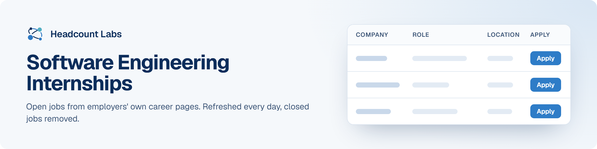

# Software Engineering Internships

Open software engineering, developer and DevOps internships and co-ops at US employers.

**76 open jobs** · 9 new since the last update · 12 removed because they closed or left the employer's board · updated November 28, 2026 at 4:32 AM EST

This list is built and refreshed every day by [Headcount Labs](https://headcountlabs.com/?utm_source=github&utm_medium=job-list&utm_campaign=software-engineering-internships), which reads jobs straight from employers' own career pages and job boards. Every job here was still listed on its source board when we last read that board, within the past 3 days, and was posted in the past 30 days. Copies of the same job are merged into one row, and jobs that close are removed at the next update.

Want this data in your own app or agent? Use the [Headcount Labs jobs API](https://headcountlabs.com/docs/?utm_source=github&utm_medium=job-list&utm_campaign=software-engineering-internships) (free tier), the [MCP server](https://headcountlabs.com/mcp/?utm_source=github&utm_medium=job-list&utm_campaign=software-engineering-internships) for Claude, ChatGPT and other AI assistants, or the [public dataset subsets](https://huggingface.co/HeadcountLabs) on Hugging Face (the full dataset is coming soon).

**Full dataset.** A bigger, one-off snapshot dated 2026-10-19 (all matching jobs, not only the open jobs below) is on Hugging Face: [Tech and software jobs](https://huggingface.co/datasets/HeadcountLabs/tech-jobs) · [Internships](https://huggingface.co/datasets/HeadcountLabs/internships). It loads with `datasets.load_dataset` and is under the Open Database License (ODbL) 1.0.

**Jump to:** [Posted in the last 7 days (5)](#posted-in-the-last-7-days) · [Posted 8 to 30 days ago (71)](#posted-8-to-30-days-ago)

**Columns.** *Apply* opens the original posting on the employer's site. *Details* opens the job on Headcount Labs, with every posting we found for it. *Remote* shows what the employer states; a dash means the posting doesn't say. *Pay* is the range the employer published.

## Posted in the last 7 days

| Company | Role | Location | Remote | Pay | Posted | Apply | Details |
| --- | --- | --- | --- | --- | --- | :---: | :---: |
| **HII** | Software Engineer, Intern - Summer 2027 - 30942 | Crane, IN | — | — | Nov 27 |  | <a href="https://headcountlabs.com/catalog/jobs/9fab9101-a795-4401-b4a7-732a888b284b?utm_source=github&utm_medium=job-list&utm_campaign=software-engineering-internships">via Headcount Labs</a> |
| **Crowe Advisory LLC** | Data Analytics Developer Intern | Chicago, IL | On-site | $27–$42/hr | Nov 25 |  | <a href="https://headcountlabs.com/catalog/jobs/8e435868-93d6-4863-860e-f06f88a74e48?utm_source=github&utm_medium=job-list&utm_campaign=software-engineering-internships">via Headcount Labs</a> |
| **Apex Technology, Inc.** | Software Engineering Internship, Test &amp; Automation (Summer 2027) | Los Angeles, CA | — | $45/hr | Nov 25 |  | <a href="https://headcountlabs.com/catalog/jobs/db5db068-ae34-48d7-8035-3f282e7de08a?utm_source=github&utm_medium=job-list&utm_campaign=software-engineering-internships">via Headcount Labs</a> |
| **Apex Technology, Inc.** | Ground Software Engineering Internship (Spring or Summer 2027) | Los Angeles, CA | — | $45/hr | Nov 25 |  | <a href="https://headcountlabs.com/catalog/jobs/46cc8498-ed1a-491a-8903-3841d10e0442?utm_source=github&utm_medium=job-list&utm_campaign=software-engineering-internships">via Headcount Labs</a> |
| **B &amp; D Industries** | Developer Intern | Albuquerque, NM | — | $17/hr | Nov 23 |  | <a href="https://headcountlabs.com/catalog/jobs/cda91b44-2617-4762-a6d9-6cf9b1b7bbdf?utm_source=github&utm_medium=job-list&utm_campaign=software-engineering-internships">via Headcount Labs</a> |

## Posted 8 to 30 days ago

| Company | Role | Location | Remote | Pay | Posted | Apply | Details |
| --- | --- | --- | --- | --- | --- | :---: | :---: |
| **Volvo Group** | Intern: Software (Summer 2027) | Shippensburg, PA | — | $17–$46/hr | Nov 20 |  | <a href="https://headcountlabs.com/catalog/jobs/55ecdd27-727c-408d-8935-cdab60fc9ef9?utm_source=github&utm_medium=job-list&utm_campaign=software-engineering-internships">via Headcount Labs</a> |
| **Sallie Mae** | Software Engineering Intern | Newark, DE | — | — | Nov 19 |  | <a href="https://headcountlabs.com/catalog/jobs/b839ba28-f3ff-47e5-a16b-5fa272bd630d?utm_source=github&utm_medium=job-list&utm_campaign=software-engineering-internships">via Headcount Labs</a> |
| **Holland America Group** | Intern, Crew Operations BI Report Developer | Seattle, WA | — | $25–$30/hr | Nov 19 |  | <a href="https://headcountlabs.com/catalog/jobs/7505fac6-722b-4660-8a01-26da45e3b0cf?utm_source=github&utm_medium=job-list&utm_campaign=software-engineering-internships">via Headcount Labs</a> |
| **Carnival Corporation** | Intern, Crew Operations BI Report Developer | Seattle, WA | — | $25–$30/hr | Nov 19 |  | <a href="https://headcountlabs.com/catalog/jobs/0481a001-1798-436b-adb2-b00146d4c822?utm_source=github&utm_medium=job-list&utm_campaign=software-engineering-internships">via Headcount Labs</a> |
| **Amperity** | Intern - Software Development Engineer | Seattle, WA | — | $55/hr | Nov 19 |  | <a href="https://headcountlabs.com/catalog/jobs/8ab432d0-47a6-41b0-91e0-912d88d9aae6?utm_source=github&utm_medium=job-list&utm_campaign=software-engineering-internships">via Headcount Labs</a> |
| **Nelnet** | Intern - IT Software Engineer (Summer 2027) | Lincoln, NE | — | $21–$25/hr | Nov 18 |  | <a href="https://headcountlabs.com/catalog/jobs/7cc13a82-c369-45b5-835e-554b58883b73?utm_source=github&utm_medium=job-list&utm_campaign=software-engineering-internships">via Headcount Labs</a> |
| **Cirrus Logic** | 2027 Internship - Software Engineer (AI/ML) | Austin, TX | Hybrid | — | Nov 18 |  | <a href="https://headcountlabs.com/catalog/jobs/9591a4f8-31e0-4755-8bc9-1ba2d67af73a?utm_source=github&utm_medium=job-list&utm_campaign=software-engineering-internships">via Headcount Labs</a> |
| **Celestica International LP** | Student Intern, Software Testing | Austin, TX | — | — | Nov 18 |  | <a href="https://headcountlabs.com/catalog/jobs/5020717f-0d67-4d33-96db-16d02a9e0138?utm_source=github&utm_medium=job-list&utm_campaign=software-engineering-internships">via Headcount Labs</a> |
| **Airbnb** | Software Engineering Intern (BS/MS) | San Francisco, CA | — | $8k/mo | Nov 18 |  | <a href="https://headcountlabs.com/catalog/jobs/05b3f6f5-27c1-40d0-a638-6a9c663f9cbe?utm_source=github&utm_medium=job-list&utm_campaign=software-engineering-internships">via Headcount Labs</a> |
| **Garmin International, Inc.** | Software Engineer Intern - Real Time Aviation Data | Chanhassen, MN | — | — | Nov 17 |  | <a href="https://headcountlabs.com/catalog/jobs/b6fb5489-b116-4ccd-a24b-ae44682ffd9b?utm_source=github&utm_medium=job-list&utm_campaign=software-engineering-internships">via Headcount Labs</a> |
| **Find a Career - Textron** | 2027 Intern - Software Engineer (Electronic Systems) - Hunt Valley, MD | Hunt Valley, MD | — | — | Nov 17 |  | <a href="https://headcountlabs.com/catalog/jobs/16bb6ecb-e1e3-48cf-8c21-a7dfc8c7062d?utm_source=github&utm_medium=job-list&utm_campaign=software-engineering-internships">via Headcount Labs</a> |
| **Tyler Technologies** | Software Development Intern, Summer 2027 | Plano, TX | — | $20–$23/hr | Nov 16 |  | <a href="https://headcountlabs.com/catalog/jobs/237009d5-73f7-4693-8ac3-76670443a9f1?utm_source=github&utm_medium=job-list&utm_campaign=software-engineering-internships">via Headcount Labs</a> |
| **Tyler Technologies** | DevOps Engineer Intern, Summer 2027 | Plano, TX | — | $20–$23/hr | Nov 16 |  | <a href="https://headcountlabs.com/catalog/jobs/dd80ab25-e859-4ea6-a005-1f064da63772?utm_source=github&utm_medium=job-list&utm_campaign=software-engineering-internships">via Headcount Labs</a> |
| **Pacific Fusion** | Summer 2027 HPC/DevOps Engineering Intern | San Leandro, CA | — | $30–$48/hr | Nov 16 |  | <a href="https://headcountlabs.com/catalog/jobs/07d79d0d-7a0d-4bcf-8ce3-aa583ff249f5?utm_source=github&utm_medium=job-list&utm_campaign=software-engineering-internships">via Headcount Labs</a> |
| **EchoStar** | Software Engineering Intern | Englewood, CO | — | $35/hr | Nov 16 |  | <a href="https://headcountlabs.com/catalog/jobs/ce55ecaf-a512-4f05-8cab-3a8e74c341a0?utm_source=github&utm_medium=job-list&utm_campaign=software-engineering-internships">via Headcount Labs</a> |
| **Qorvo** | Software Engineer Intern | Richardson, TX | — | $31–$42/hr | Nov 15 |  | <a href="https://headcountlabs.com/catalog/jobs/99c59297-0699-42eb-8e35-e0d03a3ae150?utm_source=github&utm_medium=job-list&utm_campaign=software-engineering-internships">via Headcount Labs</a> |
| **L3HHCM20** | Intern, Software Engineer (Salt Lake City, UT) | Salt Lake City, UT | — | — | Nov 13 |  | <a href="https://headcountlabs.com/catalog/jobs/3e20c5d1-fd78-4b6a-94ac-6e8bf27f1ec7?utm_source=github&utm_medium=job-list&utm_campaign=software-engineering-internships">via Headcount Labs</a> |
| **Brady Corporation** | Software Engineer Intern | 

2 locations
Plymouth, MN Milwaukee, WI
 | — | — | Nov 12 |  | <a href="https://headcountlabs.com/catalog/jobs/a51cb90f-8b4b-45b6-a89c-1ed729703ab4?utm_source=github&utm_medium=job-list&utm_campaign=software-engineering-internships">via Headcount Labs</a> |
| **Zotec Partners** | Software Engineer Intern | Carmel, IN | On-site | — | Nov 11 |  | <a href="https://headcountlabs.com/catalog/jobs/a87650b5-d76a-47e3-9108-204a206472f3?utm_source=github&utm_medium=job-list&utm_campaign=software-engineering-internships">via Headcount Labs</a> |
| **Twenty-Six Defense** | Intern - Software Engineering - Summer 2027 | Merrimack, NH | On-site | — | Nov 11 |  | <a href="https://headcountlabs.com/catalog/jobs/91a059d5-010a-4717-9b0a-404aee687d10?utm_source=github&utm_medium=job-list&utm_campaign=software-engineering-internships">via Headcount Labs</a> |
| **Minitab** | Software Quality Engineer Intern | State College, PA | — | — | Nov 11 |  | <a href="https://headcountlabs.com/catalog/jobs/9b7e82b5-66cf-4a4a-b27f-7864fb4124e6?utm_source=github&utm_medium=job-list&utm_campaign=software-engineering-internships">via Headcount Labs</a> |
| **Astranis** | Embedded Software Developer, Network/Payload Intern (Summer 2027) | San Francisco, CA | — | $29/hr | Nov 11 |  | <a href="https://headcountlabs.com/catalog/jobs/36f53c6e-ebd3-4548-8cdb-76d101b5214c?utm_source=github&utm_medium=job-list&utm_campaign=software-engineering-internships">via Headcount Labs</a> |
| **USF University of South Florida** | IAE Software Engineering Internship – Spring 2027 | Tampa, FL | On-site | $17.62/hr | Nov 10 |  | <a href="https://headcountlabs.com/catalog/jobs/09171f36-2a35-44eb-b755-fa4ff58caf13?utm_source=github&utm_medium=job-list&utm_campaign=software-engineering-internships">via Headcount Labs</a> |
| **SAS** | Summer 2027 - EVAAS Instructional Design e-Learning Developer Intern | Cary HQ, NC | — | $15–$30/hr | Nov 10 |  | <a href="https://headcountlabs.com/catalog/jobs/ed0ef2bb-46d1-4d4d-b47a-2c8d672558e9?utm_source=github&utm_medium=job-list&utm_campaign=software-engineering-internships">via Headcount Labs</a> |
| **REGENT** | Embedded Software Engineering Intern (Summer) | North Kingstown, RI | — | — | Nov 10 |  | <a href="https://headcountlabs.com/catalog/jobs/c760db44-a8f9-4d07-affa-e28a1b3b610b?utm_source=github&utm_medium=job-list&utm_campaign=software-engineering-internships">via Headcount Labs</a> |
| **REGENT** | Mission Software Engineering Intern (Summer) | North Kingstown, RI | On-site | — | Nov 10 |  | <a href="https://headcountlabs.com/catalog/jobs/2a1e6924-9fd6-49b9-b420-d4933c498b16?utm_source=github&utm_medium=job-list&utm_campaign=software-engineering-internships">via Headcount Labs</a> |
| **Palantir Technologies** | Software Engineer, Internship - Connectivity Platform and Product | 

2 locations
New York, NY Denver, CO
 | On-site | — | Nov 10 |  | <a href="https://headcountlabs.com/catalog/jobs/0eb41af2-1c82-483c-86c8-c06b2448f160?utm_source=github&utm_medium=job-list&utm_campaign=software-engineering-internships">via Headcount Labs</a> |
| **Trilogy Health Services, LLC** | Information Systems Developer of AI Intern | Louisville, KY | — | — | Nov 9 |  | <a href="https://headcountlabs.com/catalog/jobs/6ab264e9-09d7-4ef0-95f0-94457d76d56f?utm_source=github&utm_medium=job-list&utm_campaign=software-engineering-internships">via Headcount Labs</a> |
| **Pivotal** | Internship, Software Engineering (Summer 2027) | Palo Alto, CA | On-site | $30–$35/hr | Nov 9 |  | <a href="https://headcountlabs.com/catalog/jobs/a729ae63-dd01-4db5-80b8-09d69ecf3e92?utm_source=github&utm_medium=job-list&utm_campaign=software-engineering-internships">via Headcount Labs</a> |
| **Persona AI Inc** | Humanoid Robotics Software Internship | Pensacola, TX | On-site | — | Nov 9 |  | <a href="https://headcountlabs.com/catalog/jobs/feca6c8d-d0f5-429a-ba4f-903a93ec8998?utm_source=github&utm_medium=job-list&utm_campaign=software-engineering-internships">via Headcount Labs</a> |
| **L3Harris, Inc** | Software Engineering Intern | Rochester, NY | — | $24.50–$46.50/hr | Nov 9 |  | <a href="https://headcountlabs.com/catalog/jobs/bfb1f815-961e-4dd7-8bcb-80753975362e?utm_source=github&utm_medium=job-list&utm_campaign=software-engineering-internships">via Headcount Labs</a> |
| **Keysight Technologies, Inc.** | Embedded Software Engineer Intern | Cambridge, MA | — | $33.60–$36.18/hr | Nov 9 |  | <a href="https://headcountlabs.com/catalog/jobs/d00adf6b-90c9-4558-a1cb-ef9e732ea78c?utm_source=github&utm_medium=job-list&utm_campaign=software-engineering-internships">via Headcount Labs</a> |
| **Illumio** | Engineering Intern, SRE | Sunnyvale, CA | On-site | $37/hr | Nov 9 |  | <a href="https://headcountlabs.com/catalog/jobs/1aa6cb1e-3ee3-4246-8d1f-ee351af5dc9b?utm_source=github&utm_medium=job-list&utm_campaign=software-engineering-internships">via Headcount Labs</a> |
| **CesiumAstro** | Summer 2027 - Embedded Software Engineering Internship | Melbourne, FL | On-site | — | Nov 9 |  | <a href="https://headcountlabs.com/catalog/jobs/7588167b-b53f-4185-9787-d8d57d807cf7?utm_source=github&utm_medium=job-list&utm_campaign=software-engineering-internships">via Headcount Labs</a> |
| **Biodesix, Inc.** | Software Development &amp; AI Internship (Undergrad/Graduate) | Louisville, CO | On-site | $19/hr | Nov 9 |  | <a href="https://headcountlabs.com/catalog/jobs/6658ce44-a7e6-46ce-9951-832271d6d80c?utm_source=github&utm_medium=job-list&utm_campaign=software-engineering-internships">via Headcount Labs</a> |
| **L3HHCM20** | Software Engineering Intern | 

2 locations
San Diego, CA Salt Lake City, UT
 | — | — | Nov 7 |  | <a href="https://headcountlabs.com/catalog/jobs/7e489d78-72e1-47d4-b61d-e88bc11a9ffc?utm_source=github&utm_medium=job-list&utm_campaign=software-engineering-internships">via Headcount Labs</a> |
| **L3HHCM20** | Software Engineer Intern | Rochester, NY | — | $26.50–$31/hr | Nov 7 |  | <a href="https://headcountlabs.com/catalog/jobs/3699d036-3669-4f99-8341-0d497547dab1?utm_source=github&utm_medium=job-list&utm_campaign=software-engineering-internships">via Headcount Labs</a> |
| **Waymo** | 2027 Summer Intern, BS/MS, Software Engineer, Multiverse | San Francisco, CA | — | $60/hr | Nov 6 |  | <a href="https://headcountlabs.com/catalog/jobs/b0326ce8-0ab7-486f-9804-8315fbab0ba4?utm_source=github&utm_medium=job-list&utm_campaign=software-engineering-internships">via Headcount Labs</a> |
| **Republic Finance** | React Developer Intern | Plano, TX | — | — | Nov 6 |  | <a href="https://headcountlabs.com/catalog/jobs/deb97087-951c-41f3-8067-3156c0e029a9?utm_source=github&utm_medium=job-list&utm_campaign=software-engineering-internships">via Headcount Labs</a> |
| **Raft Company Website** | DevOps Engineering Intern - Summer 2027 | McLean, VA | On-site | $20–$24/hr | Nov 6 |  | <a href="https://headcountlabs.com/catalog/jobs/b798105d-e849-440c-832e-6b05fbd2382f?utm_source=github&utm_medium=job-list&utm_campaign=software-engineering-internships">via Headcount Labs</a> |
| **Raft Company Website** | Full Stack Engineering Intern - Summer 2027 | McLean, VA | — | $20–$24/hr | Nov 6 |  | <a href="https://headcountlabs.com/catalog/jobs/96be14e7-4e92-427a-8425-3b4f3c8ad84d?utm_source=github&utm_medium=job-list&utm_campaign=software-engineering-internships">via Headcount Labs</a> |
| **Notion** | Software Engineering Intern, Frontend (Summer 2027) | 

2 locations
New York, NY San Francisco, CA
 | Hybrid | — | Nov 6 |  | <a href="https://headcountlabs.com/catalog/jobs/bc54e2f3-29c7-450e-9653-21e41364f67d?utm_source=github&utm_medium=job-list&utm_campaign=software-engineering-internships">via Headcount Labs</a> |
| **Notion** | Software Engineering Intern, iOS (Summer 2027) | New York, NY | — | — | Nov 6 |  | <a href="https://headcountlabs.com/catalog/jobs/9b187603-6532-4055-92bb-a947fa2602e2?utm_source=github&utm_medium=job-list&utm_campaign=software-engineering-internships">via Headcount Labs</a> |
| **MedPro Group** | Intern - Application Developer | Fort Wayne, IN | — | — | Nov 6 |  | <a href="https://headcountlabs.com/catalog/jobs/b8ed87dd-0f94-4ee6-8eae-ea2af3986d98?utm_source=github&utm_medium=job-list&utm_campaign=software-engineering-internships">via Headcount Labs</a> |
| **Astranis** | Embedded Software Developer, Network/Payload Intern (Winter 2027) | San Francisco, CA | — | $29/hr | Nov 6 |  | <a href="https://headcountlabs.com/catalog/jobs/ae7bdaba-bfdf-4203-878b-e9954f9f5c27?utm_source=github&utm_medium=job-list&utm_campaign=software-engineering-internships">via Headcount Labs</a> |
| **Lumbermen's** | Software Developer Internship | Grand Rapids, MI | — | — | Nov 5 |  | <a href="https://headcountlabs.com/catalog/jobs/f83086e0-ec30-4c60-87f6-e9465f7c5151?utm_source=github&utm_medium=job-list&utm_campaign=software-engineering-internships">via Headcount Labs</a> |
| **Hearst** | Software Engineering Intern | Carmel, IN | — | $20–$22/hr | Nov 5 |  | <a href="https://headcountlabs.com/catalog/jobs/fd2a3fda-153d-441a-a635-3837003beaf0?utm_source=github&utm_medium=job-list&utm_campaign=software-engineering-internships">via Headcount Labs</a> |
| **Axiom Consultants** | AI Developer Intern | Rockville, MD | — | — | Nov 5 |  | <a href="https://headcountlabs.com/catalog/jobs/3e22477b-d08b-4b85-bf01-fc7fe1ff5e0c?utm_source=github&utm_medium=job-list&utm_campaign=software-engineering-internships">via Headcount Labs</a> |
| **Apex Technology, Inc.** | Software Engineering Internship, Embedded Systems (Spring or Summer 2027) | Los Angeles, CA | — | $45/hr | Nov 5 |  | <a href="https://headcountlabs.com/catalog/jobs/255961ea-5567-4e97-a6a9-c29442347cab?utm_source=github&utm_medium=job-list&utm_campaign=software-engineering-internships">via Headcount Labs</a> |
| **KEEN Footwear** | Associate Footwear Developer Intern | Portland, OR | On-site | $22/hr | Nov 4 |  | <a href="https://headcountlabs.com/catalog/jobs/3ba503ee-fa4e-47c5-8a8a-b8fdb0fea1e8?utm_source=github&utm_medium=job-list&utm_campaign=software-engineering-internships">via Headcount Labs</a> |
| **Keysight Technologies, Inc.** | R&amp;D Software Engineer, Intern | Colorado Springs, CO | — | $30.34–$32.68/hr | Nov 3 |  | <a href="https://headcountlabs.com/catalog/jobs/19dfd45e-d3ea-4088-bcdb-e6e7e5e8f43a?utm_source=github&utm_medium=job-list&utm_campaign=software-engineering-internships">via Headcount Labs</a> |
| **Roku** | Software Engineer Intern, AI Engineering | San Jose, CA | — | — | Nov 2 |  | <a href="https://headcountlabs.com/catalog/jobs/cfbe737d-7d9d-4285-bbf4-bd048852331a?utm_source=github&utm_medium=job-list&utm_campaign=software-engineering-internships">via Headcount Labs</a> |
| **ParetoHealth** | Software Engineering Summer Intern | Philadelphia, PA | — | — | Nov 2 |  | <a href="https://headcountlabs.com/catalog/jobs/56a10eed-3faf-46a4-94a3-506207d8a61f?utm_source=github&utm_medium=job-list&utm_campaign=software-engineering-internships">via Headcount Labs</a> |
| **PACCAR** | 2027 Summer Internship: Truck Systems &amp; Software Support | Denton, TX | — | — | Nov 2 |  | <a href="https://headcountlabs.com/catalog/jobs/7123e963-0ca7-41a1-88fd-2ee0fd82b0b6?utm_source=github&utm_medium=job-list&utm_campaign=software-engineering-internships">via Headcount Labs</a> |
| **Leonardo DRS, Inc.** | Embedded Software Engineer Intern | Bridgeton, MO | — | $41k–$53k/yr | Nov 2 |  | <a href="https://headcountlabs.com/catalog/jobs/bf192035-5a9e-4848-a417-a1754dc608e2?utm_source=github&utm_medium=job-list&utm_campaign=software-engineering-internships">via Headcount Labs</a> |
| **KEEN Footwear** | Junior Material Developer Intern | Portland, OR | On-site | $22/hr | Nov 2 |  | <a href="https://headcountlabs.com/catalog/jobs/f0c1a96f-57cc-45d7-be79-e619820a01f6?utm_source=github&utm_medium=job-list&utm_campaign=software-engineering-internships">via Headcount Labs</a> |
| **Envoy Air Inc.** | College Intern - Maintenance Training Curriculum Developer | Irving, TX | — | $22/hr | Nov 2 |  | <a href="https://headcountlabs.com/catalog/jobs/6912bb68-0e5d-457a-b434-a1a6e60c88a8?utm_source=github&utm_medium=job-list&utm_campaign=software-engineering-internships">via Headcount Labs</a> |
| **Astro Mechanica** | Software Engineering Intern | San Francisco, CA | — | $40–$55/hr | Nov 2 |  | <a href="https://headcountlabs.com/catalog/jobs/3fd51ecf-5d7a-439c-8b1e-9ff38a16ca28?utm_source=github&utm_medium=job-list&utm_campaign=software-engineering-internships">via Headcount Labs</a> |
| **Zoox** | Software Engineer Intern, Software Systems [Summer 2027] | Foster City, CA | Hybrid | $6k–$10k/yr | Oct 30 |  | <a href="https://headcountlabs.com/catalog/jobs/d8bdac13-9bd1-4ba8-9471-102965f610df?utm_source=github&utm_medium=job-list&utm_campaign=software-engineering-internships">via Headcount Labs</a> |
| **Zoox** | PhD Software Engineer Intern, Autonomy Software [Summer 2027] | Foster City, CA | Hybrid | $6k–$10k/yr | Oct 30 |  | <a href="https://headcountlabs.com/catalog/jobs/537ed6a0-da19-443b-a8c2-10fff1017220?utm_source=github&utm_medium=job-list&utm_campaign=software-engineering-internships">via Headcount Labs</a> |
| **Zoox** | Software Engineer Intern, Software Platforms &amp; Product [Summer 2027] | Foster City, CA | Hybrid | $6k–$10k/yr | Oct 30 |  | <a href="https://headcountlabs.com/catalog/jobs/0b5a8e3f-6780-4712-99a2-79e778c4051c?utm_source=github&utm_medium=job-list&utm_campaign=software-engineering-internships">via Headcount Labs</a> |
| **Nintendo** | Intern - Software Engineer, Performance Tools (NTD) | Redmond, WA | — | $45/hr | Oct 30 |  | <a href="https://headcountlabs.com/catalog/jobs/7c22a5b7-0cb9-466d-b5df-667f07430851?utm_source=github&utm_medium=job-list&utm_campaign=software-engineering-internships">via Headcount Labs</a> |
| **Nintendo** | Intern - Software Engineer, Graphics (NTD) | Redmond, WA | — | $45/hr | Oct 30 |  | <a href="https://headcountlabs.com/catalog/jobs/49a9bb9b-9956-41d9-8b87-56c2ab9b8e67?utm_source=github&utm_medium=job-list&utm_campaign=software-engineering-internships">via Headcount Labs</a> |
| **Leonardo DRS, Inc.** | 2027 Summer - Full Stack Software Engineering Intern - Melbourne FL | Melbourne, FL | — | — | Oct 30 |  | <a href="https://headcountlabs.com/catalog/jobs/9bce3a10-93ad-4865-b18a-6b87ed4c04f9?utm_source=github&utm_medium=job-list&utm_campaign=software-engineering-internships">via Headcount Labs</a> |
| **USAFacts** | AI &amp; Software Engineering Intern | Bellevue, WA | Hybrid | $38/hr | Oct 29 |  | <a href="https://headcountlabs.com/catalog/jobs/8f4f9105-94a8-484b-947e-5bdc763d5f5d?utm_source=github&utm_medium=job-list&utm_campaign=software-engineering-internships">via Headcount Labs</a> |
| **Talos** | Software Engineer Intern, RFQ | New York, NY | On-site | $50/hr | Oct 29 |  | <a href="https://headcountlabs.com/catalog/jobs/51b7f1fb-0ab7-4a14-8069-d2e2350d84f4?utm_source=github&utm_medium=job-list&utm_campaign=software-engineering-internships">via Headcount Labs</a> |
| **Talos** | Software Engineer Intern, Dealer | New York, NY | On-site | $50/hr | Oct 29 |  | <a href="https://headcountlabs.com/catalog/jobs/ab7bd3bc-0b91-4f3c-bbde-9feb50b773fc?utm_source=github&utm_medium=job-list&utm_campaign=software-engineering-internships">via Headcount Labs</a> |
| **Samsung Semiconductor** | Intern, Systems Software Engineering | San Jose, CA | On-site | $28–$68/hr | Oct 29 |  | <a href="https://headcountlabs.com/catalog/jobs/be80a2f4-6ec6-4efd-a34f-f09b50f52bcd?utm_source=github&utm_medium=job-list&utm_campaign=software-engineering-internships">via Headcount Labs</a> |
| **Nintendo** | Intern - Software Engineer, Connectivity (NTD) | Redmond, WA | — | $45/hr | Oct 29 |  | <a href="https://headcountlabs.com/catalog/jobs/866f8379-1641-4619-b395-188ed68266c3?utm_source=github&utm_medium=job-list&utm_campaign=software-engineering-internships">via Headcount Labs</a> |
| **Genius AI** | Software Engineer Intern Winter 2026-2027 | United States | Hybrid | $25–$50/hr | Oct 29 |  | <a href="https://headcountlabs.com/catalog/jobs/d999a217-99ef-4e40-80dc-5a56dbfaa3ee?utm_source=github&utm_medium=job-list&utm_campaign=software-engineering-internships">via Headcount Labs</a> |
| **Emerson** | Software Engineering Intern | Austin, TX | Hybrid | — | Oct 29 |  | <a href="https://headcountlabs.com/catalog/jobs/a754975b-dea8-4820-b1a3-8069c7510065?utm_source=github&utm_medium=job-list&utm_campaign=software-engineering-internships">via Headcount Labs</a> |

## Related data on Headcount Labs

- [Software engineer salary data from posted pay](https://headcountlabs.com/salary-data/software-engineer/)
- [Software engineer job postings dataset](https://headcountlabs.com/data/software-engineer-job-postings/)
- [US job market report: open jobs by state, top employers, pay and remote share](https://headcountlabs.com/reports/us-job-market/)

## More lists from Headcount Labs

[Data Science, AI and Machine Learning Internships](https://github.com/HeadcountLabs/data-science-ai-internships) · [Engineering Internships](https://github.com/HeadcountLabs/engineering-internships) · [Business, Finance and Marketing Internships](https://github.com/HeadcountLabs/business-finance-internships) · [Internships in the US](https://github.com/HeadcountLabs/internships) · [New Grad Software Engineer Jobs](https://github.com/HeadcountLabs/new-grad-software-engineer-jobs) · [Entry-Level and New Grad Jobs](https://github.com/HeadcountLabs/entry-level-jobs) · [Entry-Level Data Analyst Jobs](https://github.com/HeadcountLabs/entry-level-data-analyst-jobs) · [Remote Software Engineer Jobs](https://github.com/HeadcountLabs/remote-software-engineer-jobs) · [Remote Data, AI and Machine Learning Jobs](https://github.com/HeadcountLabs/remote-data-jobs) · [Remote Product Manager Jobs](https://github.com/HeadcountLabs/remote-product-manager-jobs) · [Remote Marketing Jobs](https://github.com/HeadcountLabs/remote-marketing-jobs) · [Remote Sales Jobs](https://github.com/HeadcountLabs/remote-sales-jobs) · [Remote Customer Support and Success Jobs](https://github.com/HeadcountLabs/remote-customer-support-jobs) · [Remote Healthcare Jobs](https://github.com/HeadcountLabs/remote-healthcare-jobs) · [Remote Finance and Accounting Jobs](https://github.com/HeadcountLabs/remote-finance-accounting-jobs) · [Remote Jobs in the US](https://github.com/HeadcountLabs/remote-jobs) · [AI and Machine Learning Engineer Jobs](https://github.com/HeadcountLabs/ai-ml-engineer-jobs) · [Data Engineer Jobs](https://github.com/HeadcountLabs/data-engineer-jobs) · [Cybersecurity Jobs](https://github.com/HeadcountLabs/cybersecurity-jobs) · [Product Manager Jobs](https://github.com/HeadcountLabs/product-manager-jobs) · [Registered Nurse Jobs](https://github.com/HeadcountLabs/registered-nurse-jobs) · [Software Jobs Paying $200k+](https://github.com/HeadcountLabs/high-paying-software-jobs) · [Tech and Software Jobs in the US](https://github.com/HeadcountLabs/tech-jobs) · [Jobs with Salary Listed in the US](https://github.com/HeadcountLabs/pay-transparency-jobs) · [San Francisco Bay Area Tech Jobs](https://github.com/HeadcountLabs/bay-area-tech-jobs) · [New York City Tech Jobs](https://github.com/HeadcountLabs/new-york-tech-jobs) · [Seattle Tech Jobs](https://github.com/HeadcountLabs/seattle-tech-jobs) · [Austin Tech Jobs](https://github.com/HeadcountLabs/austin-tech-jobs) · [Boston Tech Jobs](https://github.com/HeadcountLabs/boston-tech-jobs) · [Los Angeles Tech Jobs](https://github.com/HeadcountLabs/los-angeles-tech-jobs) · [Washington, DC Tech Jobs](https://github.com/HeadcountLabs/washington-dc-tech-jobs)

## Contributing

This README is generated, so edits to it are overwritten at the next update. If a job is closed, a link is broken or a detail is wrong, [open an issue](../../issues/new) with the link and we'll fix it in the data, which fixes it everywhere. Requests for new lists are welcome too.

## License

The list data is under the [Open Database License (ODbL) 1.0](LICENSE). Our own values in it are under the [Database Contents License (DbCL) 1.0](https://opendatacommons.org/licenses/dbcl/1-0/). Credit "Headcount Labs (https://headcountlabs.com)" when you reuse it. Job description text is the employer's own text and is not licensed by us. Takedown requests: [https://headcountlabs.com/remove/](https://headcountlabs.com/remove/). Location data includes data from OpenStreetMap contributors (ODbL) and Overture Maps. The same rows are in [`data/jobs.csv`](data/jobs.csv).

Generated by Headcount Labs from the jobs API on November 28, 2026 at 4:32 AM EST. At most 8 jobs per employer are shown in each list.
