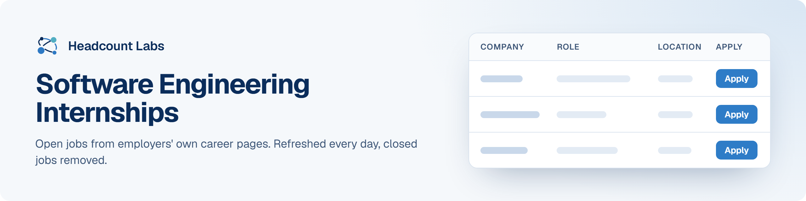

# Software Engineering Internships

Open software engineering, developer and DevOps internships and co-ops at US employers.

**101 open jobs** · first published October 18, 2026 at 6:16 PM EDT

This list is built and refreshed every day by [Headcount Labs](https://headcountlabs.com/?utm_source=github&utm_medium=job-list&utm_campaign=software-engineering-internships), which reads jobs straight from employers' own career pages and job boards. Every job here was still listed on its source board when we last read that board, within the past 3 days, and was posted in the past 30 days. Copies of the same job are merged into one row, and jobs that close are removed at the next update.

Want this data in your own app or agent? Use the [Headcount Labs jobs API](https://headcountlabs.com/docs/?utm_source=github&utm_medium=job-list&utm_campaign=software-engineering-internships) (free tier) or the [open dataset](https://huggingface.co/datasets/HeadcountLabs/job-postings) on Hugging Face.

**Jump to:** [Posted in the last 7 days (34)](#posted-in-the-last-7-days) · [Posted 8 to 30 days ago (67)](#posted-8-to-30-days-ago)

**Columns.** *Apply* opens the original posting on the employer's site. *Details* opens the job on Headcount Labs, with every posting we found for it. *Remote* shows what the employer states; a dash means the posting doesn't say. *Pay* is the range the employer published.

## Posted in the last 7 days

| Company | Role | Location | Remote | Pay | Posted | Apply | Details |
| --- | --- | --- | --- | --- | --- | :---: | :---: |
| **Health Care Service Corporation** | Early Careers - Finance Data &amp; Analytics Developer Intern | 

2 locations
Chicago, IL Richardson, TX
 | Hybrid | $19.13–$34.17/hr | Oct 17 |  | <a href="https://headcountlabs.com/catalog/jobs/492ae9cb-fe9c-4a06-9661-b59324948d03?utm_source=github&utm_medium=job-list&utm_campaign=software-engineering-internships">via Headcount Labs</a> |
| **Health Care Service Corporation** | Early Careers - Finance Application Developer Intern | 

2 locations
Chicago, IL Richardson, TX
 | Hybrid | $19.13–$34.17/hr | Oct 17 |  | <a href="https://headcountlabs.com/catalog/jobs/181d1479-f824-4bbc-bd0f-98ca0e4c6fdb?utm_source=github&utm_medium=job-list&utm_campaign=software-engineering-internships">via Headcount Labs</a> |
| **Wellmark, Inc.** | Software Engineer Internship – Technology Health Plan | Des Moines, IA | Hybrid | — | Oct 16 |  | <a href="https://headcountlabs.com/catalog/jobs/64a1a720-3a62-452a-b96f-18befa45133d?utm_source=github&utm_medium=job-list&utm_campaign=software-engineering-internships">via Headcount Labs</a> |
| **Ryan, LLC** | Summer 2027 Intern, Software Development | Plano | On-site | — | Oct 16 |  | <a href="https://headcountlabs.com/catalog/jobs/fb59df13-e051-4ae7-b2ad-8d56328a224c?utm_source=github&utm_medium=job-list&utm_campaign=software-engineering-internships">via Headcount Labs</a> |
| **Ryan, LLC** | Summer 2027 Intern, Software Engineering | Plano | On-site | — | Oct 16 |  | <a href="https://headcountlabs.com/catalog/jobs/b8c3f867-0535-4810-a9c0-52cdfdff18e4?utm_source=github&utm_medium=job-list&utm_campaign=software-engineering-internships">via Headcount Labs</a> |
| **Leonardo DRS, Inc.** | Senior Technical Intern - Software | San Diego, CA | — | $22.67–$32.42/hr | Oct 16 |  | <a href="https://headcountlabs.com/catalog/jobs/2deac998-2b8a-4c0d-9286-ff6a1da56c70?utm_source=github&utm_medium=job-list&utm_campaign=software-engineering-internships">via Headcount Labs</a> |
| **Keysight Technologies, Inc.** | R&amp;D Software Engineer Intern | 

4 locations
Santa Rosa, CA Colorado Springs, CO Austin, TX Calabasas, CA
 | On-site | $32.77–$43.42/hr | Oct 16 |  | <a href="https://headcountlabs.com/catalog/jobs/f5d2d2fa-3c3d-4040-a4a7-1c657d6240be?utm_source=github&utm_medium=job-list&utm_campaign=software-engineering-internships">via Headcount Labs</a> |
| **Jasper Engine Exchange, Inc.** | IT Full Stack Developer Internship: Summer 2027 | Jasper, IN | — | — | Oct 16 |  | <a href="https://headcountlabs.com/catalog/jobs/bcc85a9e-d3fb-42b2-88b0-5eb444e6da5e?utm_source=github&utm_medium=job-list&utm_campaign=software-engineering-internships">via Headcount Labs</a> |
| **Inter Miami CF LLC** | Intern, Software Engineer &#124; Sprint Season | Miami, FL | — | — | Oct 16 |  | <a href="https://headcountlabs.com/catalog/jobs/79e81412-3f29-4dfe-90b0-aee3610c187b?utm_source=github&utm_medium=job-list&utm_campaign=software-engineering-internships">via Headcount Labs</a> |
| **Impulse Space** | Enterprise Software Engineering Intern (Summer 2027) | Redondo Beach, CA | On-site | $32/hr | Oct 16 |  | <a href="https://headcountlabs.com/catalog/jobs/436c89eb-4524-4017-aaeb-fa1e30578716?utm_source=github&utm_medium=job-list&utm_campaign=software-engineering-internships">via Headcount Labs</a> |
| **Bird Rock Systems** | AI Developer Intern | San Diego, CA | Hybrid | $25/hr | Oct 16 |  | <a href="https://headcountlabs.com/catalog/jobs/21e7ee00-9ca9-480c-8a57-1d7f97540d45?utm_source=github&utm_medium=job-list&utm_campaign=software-engineering-internships">via Headcount Labs</a> |
| **B &amp; D INDUSTRIES INC** | Developer Intern | Albuquerque, NM | — | — | Oct 16 |  | <a href="https://headcountlabs.com/catalog/jobs/cda91b44-2617-4762-a6d9-6cf9b1b7bbdf?utm_source=github&utm_medium=job-list&utm_campaign=software-engineering-internships">via Headcount Labs</a> |
| **Assort Health** | Software Engineering Internship (Jan - Apr 2027) | San Francisco, CA | On-site | $110k–$125k/yr | Oct 16 |  | <a href="https://headcountlabs.com/catalog/jobs/d626dacf-f8b9-4831-a366-ceec319dc20b?utm_source=github&utm_medium=job-list&utm_campaign=software-engineering-internships">via Headcount Labs</a> |
| **AiDASH, Inc.** | Software Engineering Intern, Backend | Palo Alto, CA | Hybrid | — | Oct 16 |  | <a href="https://headcountlabs.com/catalog/jobs/481097f9-4bef-49ae-a3ea-278d3e3678c6?utm_source=github&utm_medium=job-list&utm_campaign=software-engineering-internships">via Headcount Labs</a> |
| **SubCom** | Applications Developer Intern (7936) | Newington, NH | — | — | Oct 15 |  | <a href="https://headcountlabs.com/catalog/jobs/c1c24cfb-4a91-4df6-a27f-9dcc3ac9d967?utm_source=github&utm_medium=job-list&utm_campaign=software-engineering-internships">via Headcount Labs</a> |
| **Sandia National Laboratories** | Intern, R&amp;D Graduate Year-Round - Smart Electronics Software - Hybrid | Albuquerque, NM | Hybrid | — | Oct 15 |  | <a href="https://headcountlabs.com/catalog/jobs/b22abc5e-86b6-4f25-b359-719299393be1?utm_source=github&utm_medium=job-list&utm_campaign=software-engineering-internships">via Headcount Labs</a> |
| **Rivian** | Software Engineering Intern - Machine Learning Research, Perception (Spring 2027 Co-Op) | Palo Alto, CA | — | $33–$51/hr | Oct 15 |  | <a href="https://headcountlabs.com/catalog/jobs/333dd5b9-9801-4cf5-8c5f-ffc7d9f6aa82?utm_source=github&utm_medium=job-list&utm_campaign=software-engineering-internships">via Headcount Labs</a> |
| **Muon Space** | Ground Software Engineering Intern (Summer 2027) | San Jose, CA | — | $40/hr | Oct 15 |  | <a href="https://headcountlabs.com/catalog/jobs/422fd955-0799-4c8f-a434-06c6b340c1c8?utm_source=github&utm_medium=job-list&utm_campaign=software-engineering-internships">via Headcount Labs</a> |
| **Inversion** | Avionics Embedded Software Engineer - Summer Internship 2027 | Playa Vista, CA | — | $38–$41/hr | Oct 15 |  | <a href="https://headcountlabs.com/catalog/jobs/5a3097db-2ee9-4a8e-a2f1-703e9ed91d06?utm_source=github&utm_medium=job-list&utm_campaign=software-engineering-internships">via Headcount Labs</a> |
| **Indeed** | Software Engineer Intern | Seattle, WA | — | $40–$50/hr | Oct 15 |  | <a href="https://headcountlabs.com/catalog/jobs/c611d911-a168-49eb-aa0a-7a1c714142b4?utm_source=github&utm_medium=job-list&utm_campaign=software-engineering-internships">via Headcount Labs</a> |
| **Healthpeak Properties** | Forward Deployed Software Engineer Internship | 

2 locations
New York City, NY Irvine, CA
 | On-site | $25/hr | Oct 15 |  | <a href="https://headcountlabs.com/catalog/jobs/dcf645ed-1817-466d-9702-d31db2341f63?utm_source=github&utm_medium=job-list&utm_campaign=software-engineering-internships">via Headcount Labs</a> |
| **Garmin International, Inc.** | Software Engineer Intern | Brea, CA | — | — | Oct 15 |  | <a href="https://headcountlabs.com/catalog/jobs/ba9fa59c-27fb-4a0a-a6c0-5769bea63f23?utm_source=github&utm_medium=job-list&utm_campaign=software-engineering-internships">via Headcount Labs</a> |
| **Carrier** | Software Engineering Intern - Summer | East Syracuse, NY | On-site | $44k–$88k/yr | Oct 15 |  | <a href="https://headcountlabs.com/catalog/jobs/02fc03a3-2923-449c-b7ec-f999c7c3e7c3?utm_source=github&utm_medium=job-list&utm_campaign=software-engineering-internships">via Headcount Labs</a> |
| **CAI** | Software Developer Intern | United States | Remote | — | Oct 15 |  | <a href="https://headcountlabs.com/catalog/jobs/bbf46e6f-c589-4a34-bf3e-a13f9d4c8e79?utm_source=github&utm_medium=job-list&utm_campaign=software-engineering-internships">via Headcount Labs</a> |
| **AutoStore System Inc.** | Software Engineering Coop | Atlanta, GA | — | — | Oct 15 |  | <a href="https://headcountlabs.com/catalog/jobs/2d391c70-eba5-446f-b416-605248ddfe3c?utm_source=github&utm_medium=job-list&utm_campaign=software-engineering-internships">via Headcount Labs</a> |
| **American Century Investments** | Software Developer Intern | Kansas City, MO | On-site | — | Oct 15 |  | <a href="https://headcountlabs.com/catalog/jobs/c18a7a3d-a83b-4b1c-9b91-330fd15371fb?utm_source=github&utm_medium=job-list&utm_campaign=software-engineering-internships">via Headcount Labs</a> |
| **Skydio** | Manufacturing Software Engineer Intern - Winter 2027 | San Mateo, CA | Hybrid | — | Oct 14 |  | <a href="https://headcountlabs.com/catalog/jobs/8509c949-17e2-4d0a-aa8b-d061a09e0d06?utm_source=github&utm_medium=job-list&utm_campaign=software-engineering-internships">via Headcount Labs</a> |
| **Point72** | 2027 Summer Internship – Software Engineer | New York, NY | — | $130k/yr | Oct 14 |  | <a href="https://headcountlabs.com/catalog/jobs/f5c62aef-c52a-411c-a7a0-8878d5602aab?utm_source=github&utm_medium=job-list&utm_campaign=software-engineering-internships">via Headcount Labs</a> |
| **Figure** | Embedded Software Engineering Intern [Winter 2027] | San Jose, CA | — | $40–$45/hr | Oct 14 |  | <a href="https://headcountlabs.com/catalog/jobs/b15cdf8a-d49b-46c0-a40e-82ddfcc755cd?utm_source=github&utm_medium=job-list&utm_campaign=software-engineering-internships">via Headcount Labs</a> |
| **Schweitzer Engineering Laboratories, Inc.** | Software Engineer Intern | 

2 locations
Boise, ID Spokane Valley, WA
 | — | $24.25–$33/hr | Oct 13 |  | <a href="https://headcountlabs.com/catalog/jobs/803aa696-cef6-43bd-99d1-b239a844d703?utm_source=github&utm_medium=job-list&utm_campaign=software-engineering-internships">via Headcount Labs</a> |
| **Medpace, Inc.** | Python Developer Internship - Summer 2027 | Cincinnati, OH | — | — | Oct 13 |  | <a href="https://headcountlabs.com/catalog/jobs/5aa51808-e08e-412f-b36f-d7f2b8b19c97?utm_source=github&utm_medium=job-list&utm_campaign=software-engineering-internships">via Headcount Labs</a> |
| **DriveTime Sales and Finance Company, LLC** | Software Engineering Intern (Summer 2027) | Tempe, AZ | Remote | — | Oct 13 |  | <a href="https://headcountlabs.com/catalog/jobs/bb15f68d-72fb-4c7d-8f4a-80a83fbb6b12?utm_source=github&utm_medium=job-list&utm_campaign=software-engineering-internships">via Headcount Labs</a> |
| **Symbotic** | Intern- Software Engineer | 

2 locations
Wilmington, MA USA Wilmington, MA - HQ
 | On-site | $32–$44/hr | Oct 12 |  | <a href="https://headcountlabs.com/catalog/jobs/e998a6ce-9ea0-40f1-9c77-2ed623391aaa?utm_source=github&utm_medium=job-list&utm_campaign=software-engineering-internships">via Headcount Labs</a> |
| **Cboe Global Markets** | Software Engineer Intern (C++) | Kansas City, MO | — | $22–$42/hr | Oct 12 |  | <a href="https://headcountlabs.com/catalog/jobs/c1af84b2-3c3a-4d0a-afb9-529e33d1e24b?utm_source=github&utm_medium=job-list&utm_campaign=software-engineering-internships">via Headcount Labs</a> |

## Posted 8 to 30 days ago

| Company | Role | Location | Remote | Pay | Posted | Apply | Details |
| --- | --- | --- | --- | --- | --- | :---: | :---: |
| **Applied Materials** | Software Engineering Summer Intern (Masters - Santa Clara, CA) | Santa Clara, CA | — | — | Oct 10 |  | <a href="https://headcountlabs.com/catalog/jobs/e3d2da59-0219-4ab9-8ccd-0c04bcbb38a9?utm_source=github&utm_medium=job-list&utm_campaign=software-engineering-internships">via Headcount Labs</a> |
| **USA Wind River** | Linux Software Development Intern | WR | — | — | Oct 9 |  | <a href="https://headcountlabs.com/catalog/jobs/ed770b7f-9fb1-44fc-bf23-5abe5b909cb0?utm_source=github&utm_medium=job-list&utm_campaign=software-engineering-internships">via Headcount Labs</a> |
| **DocuSign** | Software Engineer Intern | 

2 locations
Chicago, IL Seattle, WA
 | — | $38–$42/hr | Oct 9 |  | <a href="https://headcountlabs.com/catalog/jobs/a9566e2a-98d1-4238-8868-9db7bce45cb9?utm_source=github&utm_medium=job-list&utm_campaign=software-engineering-internships">via Headcount Labs</a> |
| **SoloPulse** | Software Engineer Intern/Co-op - Spring 2027 | Peachtree Corners, GA | Hybrid | — | Oct 8 |  | <a href="https://headcountlabs.com/catalog/jobs/9f925035-f6d2-4b30-b5c4-48203f689903?utm_source=github&utm_medium=job-list&utm_campaign=software-engineering-internships">via Headcount Labs</a> |
| **Intel** | Software Research Engineering - (PhD Intern) | Hillsboro, OR | On-site | $150k–$150k/yr | Oct 8 |  | <a href="https://headcountlabs.com/catalog/jobs/81dc457b-ed4e-4b7e-acc0-eb2af39b1a21?utm_source=github&utm_medium=job-list&utm_campaign=software-engineering-internships">via Headcount Labs</a> |
| **DocuSign** | Software Engineer Intern - Observability (Platform) | Seattle, WA | — | $38–$45/hr | Oct 8 |  | <a href="https://headcountlabs.com/catalog/jobs/920901dc-1c0a-469f-a775-7796a316f423?utm_source=github&utm_medium=job-list&utm_campaign=software-engineering-internships">via Headcount Labs</a> |
| **Boeing** | Boeing Engineering &amp; Technology Innovation Graduate Researcher Program, Software Engineering Artificial Intelligence Intern | Tukwila, WA | — | — | Oct 8 |  | <a href="https://headcountlabs.com/catalog/jobs/76037b4a-62a7-4117-b138-2d44c26f2818?utm_source=github&utm_medium=job-list&utm_campaign=software-engineering-internships">via Headcount Labs</a> |
| **McKesson** | Software Engineering Intern - Summer 2027 | 

3 locations
Irving, TX Columbus, OH United States
 | Remote | $17.33–$28.88/hr | Oct 7 |  | <a href="https://headcountlabs.com/catalog/jobs/e772842a-5d00-4510-a2b6-773c373227e4?utm_source=github&utm_medium=job-list&utm_campaign=software-engineering-internships">via Headcount Labs</a> |
| **Illinois Tool Works** | Summer 2027 Software Engineer Intern (Application Software) | Eden Prairie, MN | — | $20–$28/hr | Oct 7 |  | <a href="https://headcountlabs.com/catalog/jobs/2bc85848-daed-4c6c-805c-bbd5e4d30ca8?utm_source=github&utm_medium=job-list&utm_campaign=software-engineering-internships">via Headcount Labs</a> |
| **Dow Jones** | Summer 2027 Internship Program – Software Engineering Intern | NEW YORK, NY | On-site | $28/hr | Oct 7 |  | <a href="https://headcountlabs.com/catalog/jobs/d9397617-6b4e-4cb6-bb1e-0364d568fa44?utm_source=github&utm_medium=job-list&utm_campaign=software-engineering-internships">via Headcount Labs</a> |
| **Waymo** | 2027 Summer Intern, MS, PhD, Software Engineer | Mountain View, CA | — | $70/hr | Oct 6 |  | <a href="https://headcountlabs.com/catalog/jobs/ca4a6fe4-0735-4ca9-81a9-928914df7b0b?utm_source=github&utm_medium=job-list&utm_campaign=software-engineering-internships">via Headcount Labs</a> |
| **Keysight Technologies, Inc.** | Software Development Engineer Intern - 6G Digital Twin and Visualization Platform | Santa Rosa, CA | — | — | Oct 6 |  | <a href="https://headcountlabs.com/catalog/jobs/dc198534-978b-4ca2-a69d-36432cdc0fdb?utm_source=github&utm_medium=job-list&utm_campaign=software-engineering-internships">via Headcount Labs</a> |
| **Waymo** | 2027 Summer Intern, MS/PhD, Software Engineer, Eval Data Infra | Mountain View, CA | — | $70/hr | Oct 5 |  | <a href="https://headcountlabs.com/catalog/jobs/003faa76-60df-4390-81a1-49e7b4179d98?utm_source=github&utm_medium=job-list&utm_campaign=software-engineering-internships">via Headcount Labs</a> |
| **Rivian** | Software Engineering Intern - Embedded Software (Spring 2027 Co-op) | Palo Alto, CA | — | $45–$51/hr | Oct 5 |  | <a href="https://headcountlabs.com/catalog/jobs/e2af4303-c733-4f2b-b575-47f3bfaded99?utm_source=github&utm_medium=job-list&utm_campaign=software-engineering-internships">via Headcount Labs</a> |
| **Keysight Technologies, Inc.** | R&amp;D Software Engineering Internship | Colorado Springs, CO | — | $38.09–$41.02/hr | Oct 5 |  | <a href="https://headcountlabs.com/catalog/jobs/c8bc4a8f-f39d-4d72-b6d0-097e7d496738?utm_source=github&utm_medium=job-list&utm_campaign=software-engineering-internships">via Headcount Labs</a> |
| **Keysight Technologies, Inc.** | Enterprise Software Development (EDA Tools) Intern | Santa Rosa, CA | — | $49.83–$58.88/hr | Oct 5 |  | <a href="https://headcountlabs.com/catalog/jobs/54284ede-658e-4d27-9bd3-0beca4a485e8?utm_source=github&utm_medium=job-list&utm_campaign=software-engineering-internships">via Headcount Labs</a> |
| **Harris** | Software Engineering Intern | 

4 locations
Carlsbad, CA Sunrise, FL Rochester, NY Salt Lake City, UT
 | — | $29–$35/hr | Oct 5 |  | <a href="https://headcountlabs.com/catalog/jobs/cf3fa3d3-00fb-4b3d-8135-edeec89a4653?utm_source=github&utm_medium=job-list&utm_campaign=software-engineering-internships">via Headcount Labs</a> |
| **The Hartford** | Tech &amp; Data Program Summer 2027 - Software Engineer Intern (Hartford) | Hartford, CT | Hybrid | — | Oct 2 |  | <a href="https://headcountlabs.com/catalog/jobs/4e315fce-d9f1-4c6e-a97b-9e87cb8f1ac7?utm_source=github&utm_medium=job-list&utm_campaign=software-engineering-internships">via Headcount Labs</a> |
| **Intel** | Software Engineering - PhD Intern | Hillsboro, OR | On-site | $150k–$150k/yr | Oct 2 |  | <a href="https://headcountlabs.com/catalog/jobs/f9366d8a-cda8-41e4-916c-3c539829c59b?utm_source=github&utm_medium=job-list&utm_campaign=software-engineering-internships">via Headcount Labs</a> |
| **Harvey** | Software Engineering Intern (Summer 2027) | New York, NY | Hybrid | $62–$72/hr | Oct 2 |  | <a href="https://headcountlabs.com/catalog/jobs/b8c3efec-03cc-4780-85fc-f4ec71dc66b3?utm_source=github&utm_medium=job-list&utm_campaign=software-engineering-internships">via Headcount Labs</a> |
| **DocuSign** | Software Engineering Intern – Self-Service Directory Diagnostics | Seattle, WA | — | $34–$38/hr | Oct 2 |  | <a href="https://headcountlabs.com/catalog/jobs/cefae5f8-6212-4b28-b800-d4434aa8f6e5?utm_source=github&utm_medium=job-list&utm_campaign=software-engineering-internships">via Headcount Labs</a> |
| **Affirm** | Software Engineer (Machine Learning) Intern (Summer 2027) | San Francisco, CA | — | $10k/mo | Oct 2 |  | <a href="https://headcountlabs.com/catalog/jobs/7a382ada-3bf6-48f8-b677-d8a789dc7c53?utm_source=github&utm_medium=job-list&utm_campaign=software-engineering-internships">via Headcount Labs</a> |
| **Affirm** | Software Engineer Intern (Summer 2027) | San Francisco, CA | — | $10k/mo | Oct 2 |  | <a href="https://headcountlabs.com/catalog/jobs/52770e33-67dd-40de-8cda-cbca66166df3?utm_source=github&utm_medium=job-list&utm_campaign=software-engineering-internships">via Headcount Labs</a> |
| **Varda Space Industries** | Flight Software Internship - Summer 2027 | El Segundo, CA | — | $37/hr | Oct 1 |  | <a href="https://headcountlabs.com/catalog/jobs/837731f5-d2f2-4a98-ad0c-e6413e830f07?utm_source=github&utm_medium=job-list&utm_campaign=software-engineering-internships">via Headcount Labs</a> |
| **Harris** | Software Engineer Intern | 

2 locations
Columbia, MD Rochester, NY
 | — | $30.50–$35/hr | Oct 1 |  | <a href="https://headcountlabs.com/catalog/jobs/047bf364-1338-4bde-886e-566cbc3c7a5c?utm_source=github&utm_medium=job-list&utm_campaign=software-engineering-internships">via Headcount Labs</a> |
| **COSTAR REALTY INFORMATION, INC.** | Embedded Software Engineering Intern | Sunnyvale, CA | — | $40–$45/hr | Oct 1 |  | <a href="https://headcountlabs.com/catalog/jobs/d6d88e65-b763-44bf-b085-e6529da71c1b?utm_source=github&utm_medium=job-list&utm_campaign=software-engineering-internships">via Headcount Labs</a> |
| **07G Federal Reserve Bank of Chicago** | Summer 2027 Intern-Computer Science and Software Engineering | Chicago, IL | — | $20–$33/hr | Oct 1 |  | <a href="https://headcountlabs.com/catalog/jobs/57381faf-6f3b-44fc-81ae-5299e8c9230e?utm_source=github&utm_medium=job-list&utm_campaign=software-engineering-internships">via Headcount Labs</a> |
| **Waymo** | 2027 Summer Intern, BS, Software Engineering, Labeling | Mountain View, CA | — | $60/hr | Sep 30 |  | <a href="https://headcountlabs.com/catalog/jobs/93d95ab1-366f-4c50-9fa0-b22d7f49f63e?utm_source=github&utm_medium=job-list&utm_campaign=software-engineering-internships">via Headcount Labs</a> |
| **Waymo** | 2027 Summer Intern, MS/PhD, Software Engineer, Onboard Developer Platform | Mountain View, CA | — | $70/hr | Sep 30 |  | <a href="https://headcountlabs.com/catalog/jobs/1e19b6fb-ff62-4542-90e4-7896a1056fb3?utm_source=github&utm_medium=job-list&utm_campaign=software-engineering-internships">via Headcount Labs</a> |
| **Rivian** | Software Engineering Intern - Applied AI (Spring 2027 Co-Op) | Palo Alto, CA | — | $33–$51/hr | Sep 30 |  | <a href="https://headcountlabs.com/catalog/jobs/d2596188-d5a0-4d97-8023-94be22459d85?utm_source=github&utm_medium=job-list&utm_campaign=software-engineering-internships">via Headcount Labs</a> |
| **KLA Corporation** | Software Engineering Intern | Milpitas, CA | — | $37–$49/hr | Sep 30 |  | <a href="https://headcountlabs.com/catalog/jobs/3233826a-3934-4104-a598-9c48d562f36a?utm_source=github&utm_medium=job-list&utm_campaign=software-engineering-internships">via Headcount Labs</a> |
| **Illinois Tool Works** | Summer 2027 Software Engineering Intern | Eden Prairie, MN | — | $20–$29/hr | Sep 30 |  | <a href="https://headcountlabs.com/catalog/jobs/51d5f6fc-3fec-4fbf-bf3f-8bcaf42d418b?utm_source=github&utm_medium=job-list&utm_campaign=software-engineering-internships">via Headcount Labs</a> |
| **Harris** | Intern, Software Engineer | Clifton, NJ | — | $29–$53.50/hr | Sep 30 |  | <a href="https://headcountlabs.com/catalog/jobs/ad682aa9-7130-47f3-9a3b-3f9ebcca5aca?utm_source=github&utm_medium=job-list&utm_campaign=software-engineering-internships">via Headcount Labs</a> |
| **Harris** | Intern, Software Engineer (Salt Lake City, UT) | Salt Lake City, UT | — | — | Sep 30 |  | <a href="https://headcountlabs.com/catalog/jobs/9d710214-1888-4b71-8091-b804a45a58e6?utm_source=github&utm_medium=job-list&utm_campaign=software-engineering-internships">via Headcount Labs</a> |
| **Q2 SOFTWARE, INC.** | 2027 Summer Internship - Software Engineer | Cary, NC | — | — | Sep 29 |  | <a href="https://headcountlabs.com/catalog/jobs/f0bbd9fe-ac9a-47f1-9612-d46733549c0b?utm_source=github&utm_medium=job-list&utm_campaign=software-engineering-internships">via Headcount Labs</a> |
| **Keysight Technologies, Inc.** | EDA AI/ML Software Intern | Calabasas, CA | — | $40.32–$43.42/hr | Sep 29 |  | <a href="https://headcountlabs.com/catalog/jobs/7cea51cd-8d9c-482e-b895-2bbf43d7d1c2?utm_source=github&utm_medium=job-list&utm_campaign=software-engineering-internships">via Headcount Labs</a> |
| **Enova International** | Software Engineer Internship Summer 2027 (Hybrid) | Chicago, IL | Hybrid | $35/hr | Sep 29 |  | <a href="https://headcountlabs.com/catalog/jobs/9fabebd4-2935-4028-ab24-e3cc254e13df?utm_source=github&utm_medium=job-list&utm_campaign=software-engineering-internships">via Headcount Labs</a> |
| **NOVOZYMES NORTH AMERICA, INC** | Data Science / Software Development Intern | Morrisville | On-site | $28/hr | Sep 28 |  | <a href="https://headcountlabs.com/catalog/jobs/d02541c0-5cfa-446d-8ee3-9441a02524bc?utm_source=github&utm_medium=job-list&utm_campaign=software-engineering-internships">via Headcount Labs</a> |
| **Keenfinity** | Software Engineering Intern | Lincoln, NE | — | $25–$27/hr | Sep 28 |  | <a href="https://headcountlabs.com/catalog/jobs/75d12c5c-5222-4693-8e71-8b696cdd803b?utm_source=github&utm_medium=job-list&utm_campaign=software-engineering-internships">via Headcount Labs</a> |
| **H&amp;R Block** | Embark Software Engineering Intern - S | KANSAS CITY, MO | — | — | Sep 28 |  | <a href="https://headcountlabs.com/catalog/jobs/e44b5f33-74c1-498c-8c8a-ac5efcec5f6f?utm_source=github&utm_medium=job-list&utm_campaign=software-engineering-internships">via Headcount Labs</a> |
| **Waymo** | 2027 Summer Intern, BS, Software Engineer, Driver Refinement Foundations | Mountain View, CA | — | $60/hr | Sep 25 |  | <a href="https://headcountlabs.com/catalog/jobs/5cca0ac9-42c4-493a-87dc-8823e302ec96?utm_source=github&utm_medium=job-list&utm_campaign=software-engineering-internships">via Headcount Labs</a> |
| **Waymo** | 2027 Summer Intern, MS/PhD, Software Engineering, Onboard Software Integrity | Mountain View, CA | — | $70/hr | Sep 25 |  | <a href="https://headcountlabs.com/catalog/jobs/3ee2561d-15ba-498c-952e-528f3c269573?utm_source=github&utm_medium=job-list&utm_campaign=software-engineering-internships">via Headcount Labs</a> |
| **Waymo** | 2027 Summer Intern, MS/PhD, Software Engineer, Sys Intel &amp; Machine Learning | Mountain View, CA | — | $70/hr | Sep 25 |  | <a href="https://headcountlabs.com/catalog/jobs/1eca64a6-977e-4ed0-8813-fd9eb4563e2d?utm_source=github&utm_medium=job-list&utm_campaign=software-engineering-internships">via Headcount Labs</a> |
| **Rockwell Automation** | Intern, AI Software Engineering (June-August 2027) | 

2 locations
Mayfield Heights, OH Milwaukee, WI
 | Hybrid | $20–$32/hr | Sep 25 |  | <a href="https://headcountlabs.com/catalog/jobs/24073677-4053-48bd-84cf-f543d3ee932a?utm_source=github&utm_medium=job-list&utm_campaign=software-engineering-internships">via Headcount Labs</a> |
| **Pacific Life** | Summer 2027 Software Engineering Internship | United States | — | $25/hr | Sep 25 |  | <a href="https://headcountlabs.com/catalog/jobs/dde9819a-0d14-4266-8545-120f52107dbe?utm_source=github&utm_medium=job-list&utm_campaign=software-engineering-internships">via Headcount Labs</a> |
| **Keysight Technologies, Inc.** | R&amp;D Software Engineer QA DevOps, Intern | 

2 locations
Santa Rosa, CA San Diego, CA
 | On-site | $38.31–$41.25/hr | Sep 25 |  | <a href="https://headcountlabs.com/catalog/jobs/37af6d8a-37ee-480d-a8ac-07c8b02a9acb?utm_source=github&utm_medium=job-list&utm_campaign=software-engineering-internships">via Headcount Labs</a> |
| **Intel** | System Software Engineering - PhD Intern | Hillsboro, OR | Hybrid | $150k–$150k/yr | Sep 25 |  | <a href="https://headcountlabs.com/catalog/jobs/bb533834-8460-4e0c-9df6-539a9afed752?utm_source=github&utm_medium=job-list&utm_campaign=software-engineering-internships">via Headcount Labs</a> |
| **Intel** | Software Solutions PhD Intern New 2027 | Hillsboro, OR | On-site | $150k–$150k/yr | Sep 25 |  | <a href="https://headcountlabs.com/catalog/jobs/1462ab48-226f-4bd0-b083-2ed7678ecbcd?utm_source=github&utm_medium=job-list&utm_campaign=software-engineering-internships">via Headcount Labs</a> |
| **Harris** | Software Engineering Intern (Melbourne, FL) | Melbourne, FL | — | — | Sep 25 |  | <a href="https://headcountlabs.com/catalog/jobs/c33961de-5756-494c-90ae-3c6214985e3b?utm_source=github&utm_medium=job-list&utm_campaign=software-engineering-internships">via Headcount Labs</a> |
| **Waymo** | 2027 Summer Intern, PhD, Software Engineer, Simulation | Mountain View, CA | — | $85/hr | Sep 24 |  | <a href="https://headcountlabs.com/catalog/jobs/13adaef9-e031-4038-ba21-7cdf28112d66?utm_source=github&utm_medium=job-list&utm_campaign=software-engineering-internships">via Headcount Labs</a> |
| **VT Industries** | Software Development Intern | Holstein, IA | Hybrid | — | Sep 24 |  | <a href="https://headcountlabs.com/catalog/jobs/496eca2d-7f8c-4782-9d38-8f713b2ffeae?utm_source=github&utm_medium=job-list&utm_campaign=software-engineering-internships">via Headcount Labs</a> |
| **Schwan's Company** | IT Systems Developer Internship - Summer 2027 | 

2 locations
Marshall, MN Hopkins, MN
 | — | — | Sep 23 |  | <a href="https://headcountlabs.com/catalog/jobs/3b0c0ac7-1397-4944-beca-f6eb5878b34e?utm_source=github&utm_medium=job-list&utm_campaign=software-engineering-internships">via Headcount Labs</a> |
| **Sandia National Laboratories** | Intern, R&amp;D Undergraduate Summer - TITANS Software, Onsite | Albuquerque, NM | On-site | — | Sep 23 |  | <a href="https://headcountlabs.com/catalog/jobs/fb4bb5f2-a383-4007-9b78-9b174a57af21?utm_source=github&utm_medium=job-list&utm_campaign=software-engineering-internships">via Headcount Labs</a> |
| **Sandia National Laboratories** | Intern, Technical Graduate Summer - TITANS Software, Onsite | Albuquerque, NM | On-site | — | Sep 23 |  | <a href="https://headcountlabs.com/catalog/jobs/d3cb8abb-d259-4b08-8206-cafc5b14d31e?utm_source=github&utm_medium=job-list&utm_campaign=software-engineering-internships">via Headcount Labs</a> |
| **WEST BEND INSURANCE COMPANY** | Summer 2027 Internship - IT Software Engineer | West Bend, WI | — | — | Sep 22 |  | <a href="https://headcountlabs.com/catalog/jobs/06fa8bb3-7ad5-42f7-afc1-b1c65e62cde8?utm_source=github&utm_medium=job-list&utm_campaign=software-engineering-internships">via Headcount Labs</a> |
| **Rivian** | Software Engineering Intern - Product Development Portal (Spring Co-Op) | Palo Alto, CA | — | $33–$51/hr | Sep 21 |  | <a href="https://headcountlabs.com/catalog/jobs/00cad2b6-3438-40a3-bec8-1aa58b45615d?utm_source=github&utm_medium=job-list&utm_campaign=software-engineering-internships">via Headcount Labs</a> |
| **Rivian** | Software Engineering Intern - Enterprise Applications (Spring 2027 Co-Op | 

2 locations
Normal, IL Plymouth, MI
 | — | $25–$40/hr | Sep 21 |  | <a href="https://headcountlabs.com/catalog/jobs/3a40b1ab-0ea5-4efa-8796-787cdec6eef1?utm_source=github&utm_medium=job-list&utm_campaign=software-engineering-internships">via Headcount Labs</a> |
| **Rivian** | Software Engineering Intern - Product Lifecycle Management (Spring 2027 Co-Op) | Palo Alto, CA | — | $33–$51/hr | Sep 21 |  | <a href="https://headcountlabs.com/catalog/jobs/e9942459-6de3-49da-8afd-378322951e57?utm_source=github&utm_medium=job-list&utm_campaign=software-engineering-internships">via Headcount Labs</a> |
| **Rivian** | Software Engineering Intern - Design Automation (Spring 2027 Co-Op) | Palo Alto, CA | — | $33–$51/hr | Sep 21 |  | <a href="https://headcountlabs.com/catalog/jobs/e7d8eb2d-b43b-4eb0-8a05-fcf6d5dba2f2?utm_source=github&utm_medium=job-list&utm_campaign=software-engineering-internships">via Headcount Labs</a> |
| **Rippling** | Full Stack Software Engineer Intern - Summer 2027 | 

3 locations
San Francisco, CA Seattle, WA New York, NY
 | On-site | — | Sep 21 |  | <a href="https://headcountlabs.com/catalog/jobs/4ad5485c-a8a9-4ea2-90e8-27c8ba9916aa?utm_source=github&utm_medium=job-list&utm_campaign=software-engineering-internships">via Headcount Labs</a> |
| **Illinois Tool Works** | Software Engineering Intern | 

3 locations
United States Appleton, WI Rogers, MN
 | — | $19–$29/hr | Sep 21 |  | <a href="https://headcountlabs.com/catalog/jobs/36bc0aec-7f95-44a1-b166-47da70b3bf59?utm_source=github&utm_medium=job-list&utm_campaign=software-engineering-internships">via Headcount Labs</a> |
| **Conifer Health Solutions** | BI Developer Intern - Hybrid in Dallas, TX | Dallas, TX | Hybrid | — | Sep 21 |  | <a href="https://headcountlabs.com/catalog/jobs/732ef161-c914-4de9-b332-5279f825f7d4?utm_source=github&utm_medium=job-list&utm_campaign=software-engineering-internships">via Headcount Labs</a> |
| **Conifer** | BI Developer Intern - Hybrid in Dallas, TX | Dallas, TX | Hybrid | — | Sep 21 |  | <a href="https://headcountlabs.com/catalog/jobs/df269fac-9f23-4a0d-9015-de49c8d15614?utm_source=github&utm_medium=job-list&utm_campaign=software-engineering-internships">via Headcount Labs</a> |
| **ACIST MEDICAL SYSTEMS INC** | Quality Analyst Intern (Software) | Eden Prairie, MN | — | $23–$25/hr | Sep 21 |  | <a href="https://headcountlabs.com/catalog/jobs/da4ccb9a-b97a-4517-9284-20a480fd3abc?utm_source=github&utm_medium=job-list&utm_campaign=software-engineering-internships">via Headcount Labs</a> |
| **Lawrence Livermore National Laboratory** | Computing Undergraduate Student Intern: DevOps Internship Program - Summer 2027 | Livermore, CA | — | $23.26–$31.62/hr | Sep 18 |  | <a href="https://headcountlabs.com/catalog/jobs/a7ac57f4-8e1d-4d78-b7e7-42f539c9864e?utm_source=github&utm_medium=job-list&utm_campaign=software-engineering-internships">via Headcount Labs</a> |
| **Keysight Technologies, Inc.** | R&amp;D Embedded Software Intern | Colorado Springs, CO | — | $30.34–$32.68/hr | Sep 18 |  | <a href="https://headcountlabs.com/catalog/jobs/34a47ae2-a547-4b63-b138-9049b39c83d5?utm_source=github&utm_medium=job-list&utm_campaign=software-engineering-internships">via Headcount Labs</a> |
| **Berkley** | Software Developer (.NET) Intern | Urbandale, IA | — | — | Sep 18 |  | <a href="https://headcountlabs.com/catalog/jobs/787078ef-0696-4184-bc57-8c8a4f58b916?utm_source=github&utm_medium=job-list&utm_campaign=software-engineering-internships">via Headcount Labs</a> |

## More lists from Headcount Labs

[Data Science, AI and Machine Learning Internships](https://github.com/HeadcountLabs/data-science-ai-internships) · [Engineering Internships](https://github.com/HeadcountLabs/engineering-internships) · [Business, Finance and Marketing Internships](https://github.com/HeadcountLabs/business-finance-internships) · [Internships in the US](https://github.com/HeadcountLabs/internships) · [New Grad Software Engineer Jobs](https://github.com/HeadcountLabs/new-grad-software-engineer-jobs) · [Entry-Level and New Grad Jobs](https://github.com/HeadcountLabs/entry-level-jobs) · [Entry-Level Data Analyst Jobs](https://github.com/HeadcountLabs/entry-level-data-analyst-jobs) · [Remote Software Engineer Jobs](https://github.com/HeadcountLabs/remote-software-engineer-jobs) · [Remote Data, AI and Machine Learning Jobs](https://github.com/HeadcountLabs/remote-data-jobs) · [Remote Product Manager Jobs](https://github.com/HeadcountLabs/remote-product-manager-jobs) · [Remote Marketing Jobs](https://github.com/HeadcountLabs/remote-marketing-jobs) · [Remote Sales Jobs](https://github.com/HeadcountLabs/remote-sales-jobs) · [Remote Customer Support and Success Jobs](https://github.com/HeadcountLabs/remote-customer-support-jobs) · [Remote Healthcare Jobs](https://github.com/HeadcountLabs/remote-healthcare-jobs) · [Remote Finance and Accounting Jobs](https://github.com/HeadcountLabs/remote-finance-accounting-jobs) · [Remote Jobs in the US](https://github.com/HeadcountLabs/remote-jobs) · [AI and Machine Learning Engineer Jobs](https://github.com/HeadcountLabs/ai-ml-engineer-jobs) · [Data Engineer Jobs](https://github.com/HeadcountLabs/data-engineer-jobs) · [Cybersecurity Jobs](https://github.com/HeadcountLabs/cybersecurity-jobs) · [Product Manager Jobs](https://github.com/HeadcountLabs/product-manager-jobs) · [Registered Nurse Jobs](https://github.com/HeadcountLabs/registered-nurse-jobs) · [Software Jobs Paying $200k+](https://github.com/HeadcountLabs/high-paying-software-jobs) · [San Francisco Bay Area Tech Jobs](https://github.com/HeadcountLabs/bay-area-tech-jobs) · [New York City Tech Jobs](https://github.com/HeadcountLabs/new-york-tech-jobs) · [Seattle Tech Jobs](https://github.com/HeadcountLabs/seattle-tech-jobs) · [Austin Tech Jobs](https://github.com/HeadcountLabs/austin-tech-jobs) · [Boston Tech Jobs](https://github.com/HeadcountLabs/boston-tech-jobs) · [Los Angeles Tech Jobs](https://github.com/HeadcountLabs/los-angeles-tech-jobs) · [Washington, DC Tech Jobs](https://github.com/HeadcountLabs/washington-dc-tech-jobs)

## Contributing

This README is generated, so edits to it are overwritten at the next update. If a job is closed, a link is broken or a detail is wrong, [open an issue](../../issues/new) with the link and we'll fix it in the data, which fixes it everywhere. Requests for new lists are welcome too.

## License

The list data is licensed under [CC BY 4.0](LICENSE). Credit "Headcount Labs (https://headcountlabs.com)" when you reuse it. Job postings belong to the employers that published them. The same rows are in [`data/jobs.csv`](data/jobs.csv).

Generated by Headcount Labs from the jobs API on October 18, 2026 at 6:16 PM EDT. At most 8 jobs per employer are shown in each list.
