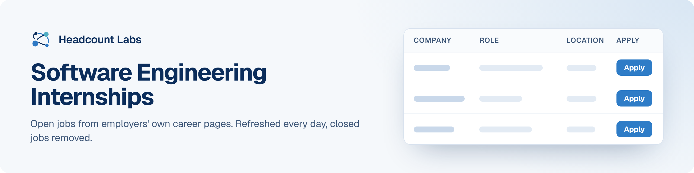

# Software Engineering Internships

Open software engineering, developer and DevOps internships and co-ops at US employers.

**123 open jobs** · 121 new since the last update · 2 removed because they closed or left the employer's board · updated November 11, 2026 at 4:31 AM EST

This list is built and refreshed every day by [Headcount Labs](https://headcountlabs.com/?utm_source=github&utm_medium=job-list&utm_campaign=software-engineering-internships), which reads jobs straight from employers' own career pages and job boards. Every job here was still listed on its source board when we last read that board, within the past 3 days, and was posted in the past 30 days. Copies of the same job are merged into one row, and jobs that close are removed at the next update.

Want this data in your own app or agent? Use the [Headcount Labs jobs API](https://headcountlabs.com/docs/?utm_source=github&utm_medium=job-list&utm_campaign=software-engineering-internships) (free tier), the [MCP server](https://headcountlabs.com/mcp/?utm_source=github&utm_medium=job-list&utm_campaign=software-engineering-internships) for Claude, ChatGPT and other AI assistants, or the [public dataset subsets](https://huggingface.co/HeadcountLabs) on Hugging Face (the full dataset is coming soon).

**Full dataset.** A bigger, one-off snapshot dated 2026-10-19 (all matching jobs, not only the open jobs below) is on Hugging Face: [Tech and software jobs](https://huggingface.co/datasets/HeadcountLabs/tech-jobs) · [Internships](https://huggingface.co/datasets/HeadcountLabs/internships). It loads with `datasets.load_dataset` and is under the Open Database License (ODbL) 1.0.

**Jump to:** [Posted in the last 7 days (49)](#posted-in-the-last-7-days) · [Posted 8 to 30 days ago (74)](#posted-8-to-30-days-ago)

**Columns.** *Apply* opens the original posting on the employer's site. *Details* opens the job on Headcount Labs, with every posting we found for it. *Remote* shows what the employer states; a dash means the posting doesn't say. *Pay* is the range the employer published.

## Posted in the last 7 days

| Company | Role | Location | Remote | Pay | Posted | Apply | Details |
| --- | --- | --- | --- | --- | --- | :---: | :---: |
| **LED FastStart** | GDIT Summer Internship Program – Summer 2027 AI/ML Software Development and Engineering Internship | Bossier City, LA | — | $19.55–$26.45/hr | Nov 11 |  | <a href="https://headcountlabs.com/catalog/jobs/7604e85d-8acb-4e08-ac02-b9bb11915794?utm_source=github&utm_medium=job-list&utm_campaign=software-engineering-internships">via Headcount Labs</a> |
| **LED FastStart** | GDIT Summer Internship Program – Summer 2027 Generative AI Software Development Internship | Bossier City, LA | — | $19.55–$26.45/hr | Nov 11 |  | <a href="https://headcountlabs.com/catalog/jobs/d27a5925-f271-4bcb-9797-a3d08e715457?utm_source=github&utm_medium=job-list&utm_campaign=software-engineering-internships">via Headcount Labs</a> |
| **LED FastStart** | GDIT Summer Internship Program – Summer 2027 Software Development Internship | Bossier City, LA | — | $19.55–$26.45/hr | Nov 11 |  | <a href="https://headcountlabs.com/catalog/jobs/f18adeee-baf2-4686-ba1d-dae0f958516f?utm_source=github&utm_medium=job-list&utm_campaign=software-engineering-internships">via Headcount Labs</a> |
| **Transcard Payments LLC** | 2027 - Software Engineer Intern | Chattanooga, TN | — | — | Nov 10 |  | <a href="https://headcountlabs.com/catalog/jobs/6485c1fe-97df-4968-95e9-0b69d476d7dc?utm_source=github&utm_medium=job-list&utm_campaign=software-engineering-internships">via Headcount Labs</a> |
| **Transcard Payments LLC** | 2027 - Software Implementation Intern | Chattanooga, TN | — | — | Nov 10 |  | <a href="https://headcountlabs.com/catalog/jobs/29a63a66-0025-4fec-9e17-58739856ab6c?utm_source=github&utm_medium=job-list&utm_campaign=software-engineering-internships">via Headcount Labs</a> |
| **McDonald** | Software Development Engineer Intern | 

2 locations
Chicago, IL United States
 | — | $32/hr | Nov 10 |  | <a href="https://headcountlabs.com/catalog/jobs/fc6c8e62-339d-4a21-ae65-b7a90c32d172?utm_source=github&utm_medium=job-list&utm_campaign=software-engineering-internships">via Headcount Labs</a> |
| **Hunt** | Application Developer Intern - Summer 2027 | Dallas, TX | On-site | — | Nov 10 |  | <a href="https://headcountlabs.com/catalog/jobs/29f11cac-ee87-43e4-812c-6fbcf0bdaab1?utm_source=github&utm_medium=job-list&utm_campaign=software-engineering-internships">via Headcount Labs</a> |
| **General Dynamics Mission Systems, Inc** | Software Test Engineering Intern - Space and Embedded Crypto | Scottsdale, AZ | Remote | — | Nov 10 |  | <a href="https://headcountlabs.com/catalog/jobs/163b4eba-36ec-4d32-9908-725f80351876?utm_source=github&utm_medium=job-list&utm_campaign=software-engineering-internships">via Headcount Labs</a> |
| **Etched** | Chip Simulation Software Intern | San Jose, CA | On-site | — | Nov 10 |  | <a href="https://headcountlabs.com/catalog/jobs/64171535-8e1f-445e-8a32-3ed197f270db?utm_source=github&utm_medium=job-list&utm_campaign=software-engineering-internships">via Headcount Labs</a> |
| **Echo Global Logistics, Inc** | Software Engineering Intern- Chicago | United States | Remote | $35k–$50k/yr | Nov 10 |  | <a href="https://headcountlabs.com/catalog/jobs/85ad6939-b121-488b-bc13-ed5eb9b08069?utm_source=github&utm_medium=job-list&utm_campaign=software-engineering-internships">via Headcount Labs</a> |
| **Addepar** | Software Engineering Intern - Summer 2027 | New York, NY | — | $48/hr | Nov 10 |  | <a href="https://headcountlabs.com/catalog/jobs/d5fbb1d7-8f19-4e3f-ae47-ed263463b0b7?utm_source=github&utm_medium=job-list&utm_campaign=software-engineering-internships">via Headcount Labs</a> |
| **Trimble Inc.** | Software Engineer Intern | Lake Oswego, OR | On-site | $22.69–$28.32/hr | Nov 9 |  | <a href="https://headcountlabs.com/catalog/jobs/c89e09bb-f7cb-49a6-8261-d6b9acecf2f7?utm_source=github&utm_medium=job-list&utm_campaign=software-engineering-internships">via Headcount Labs</a> |
| **Trilogy Health Services, LLC** | Information Systems Developer of AI Intern | Louisville, KY | — | — | Nov 9 |  | <a href="https://headcountlabs.com/catalog/jobs/6ab264e9-09d7-4ef0-95f0-94457d76d56f?utm_source=github&utm_medium=job-list&utm_campaign=software-engineering-internships">via Headcount Labs</a> |
| **Radiance Technologies, Inc.** | Software Engineer Intern Spring/Summer 2027 | Dayton | — | $21–$26/hr | Nov 9 |  | <a href="https://headcountlabs.com/catalog/jobs/b4465eaf-2253-41db-ae0a-d2b191bcc3eb?utm_source=github&utm_medium=job-list&utm_campaign=software-engineering-internships">via Headcount Labs</a> |
| **OneHope** | Front-End Developer Intern - Spring 2027 | United States | — | — | Nov 9 |  | <a href="https://headcountlabs.com/catalog/jobs/b656def5-7836-4448-ac79-d6dc7a1ea187?utm_source=github&utm_medium=job-list&utm_campaign=software-engineering-internships">via Headcount Labs</a> |
| **Mortgage Research Center, LLC** | Intern - Software Engineer - Summer 2027 | Missouri | Remote | — | Nov 9 |  | <a href="https://headcountlabs.com/catalog/jobs/2b155a90-f934-415a-8a21-8d1353208dd8?utm_source=github&utm_medium=job-list&utm_campaign=software-engineering-internships">via Headcount Labs</a> |
| **Illumio** | Engineering Intern, SRE | United States | — | — | Nov 9 |  | <a href="https://headcountlabs.com/catalog/jobs/1cd935c3-359d-42c5-944e-fcfb246443cf?utm_source=github&utm_medium=job-list&utm_campaign=software-engineering-internships">via Headcount Labs</a> |
| **HireKeyz Inc.** | Cloud Engineering &amp; DevOps Intern | United States | — | — | Nov 9 |  | <a href="https://headcountlabs.com/catalog/jobs/6e28cdce-98cd-4fb7-953f-f1bc983fa313?utm_source=github&utm_medium=job-list&utm_campaign=software-engineering-internships">via Headcount Labs</a> |
| **HireKeyz Inc.** | Full-Stack Software Engineering Intern | United States | — | — | Nov 9 |  | <a href="https://headcountlabs.com/catalog/jobs/6d7ee095-745b-4cff-8129-95956f224653?utm_source=github&utm_medium=job-list&utm_campaign=software-engineering-internships">via Headcount Labs</a> |
| **General Dynamics Mission Systems, Inc** | Full-Stack Software Engineering Intern, Summer 2027 | 

3 locations
Scottsdale, AZ Chantilly, VA Pittsfield, MA
 | — | — | Nov 9 |  | <a href="https://headcountlabs.com/catalog/jobs/10a4788f-078d-4802-a91d-9af6e3f5903d?utm_source=github&utm_medium=job-list&utm_campaign=software-engineering-internships">via Headcount Labs</a> |
| **Cisco** | Software Engineer Full-Stack / Backend I (Intern) – United States | 

3 locations
San Jose, CA Austin, TX Research Triangle Park, NC
 | Hybrid | $44k–$185k/yr | Nov 9 |  | <a href="https://headcountlabs.com/catalog/jobs/4ca78383-846b-4942-ba04-d77c3401a6de?utm_source=github&utm_medium=job-list&utm_campaign=software-engineering-internships">via Headcount Labs</a> |
| **CesiumAstro** | Summer 2027 - Embedded Software Engineering Internship | Melbourne, FL | On-site | — | Nov 9 |  | <a href="https://headcountlabs.com/catalog/jobs/7588167b-b53f-4185-9787-d8d57d807cf7?utm_source=github&utm_medium=job-list&utm_campaign=software-engineering-internships">via Headcount Labs</a> |
| **Waymo** | 2027 Summer Intern, BS/MS, Software Engineer, Multiverse | San Francisco, CA | — | $60/hr | Nov 6 |  | <a href="https://headcountlabs.com/catalog/jobs/b0326ce8-0ab7-486f-9804-8315fbab0ba4?utm_source=github&utm_medium=job-list&utm_campaign=software-engineering-internships">via Headcount Labs</a> |
| **TTM Technologies, Inc.** | Software Engineering Intern - Summer 2027 | Syracuse, NY | — | $47k–$75k/yr | Nov 6 |  | <a href="https://headcountlabs.com/catalog/jobs/eec9d1f5-0da9-4434-9dac-6b5393112b0c?utm_source=github&utm_medium=job-list&utm_campaign=software-engineering-internships">via Headcount Labs</a> |
| **The New York Times** | Android Engineering Intern | New York, NY | Hybrid | $40/hr | Nov 6 |  | <a href="https://headcountlabs.com/catalog/jobs/2592a486-5dd3-4516-a9ce-d89feb6aab97?utm_source=github&utm_medium=job-list&utm_campaign=software-engineering-internships">via Headcount Labs</a> |
| **The New York Times** | Full-Stack Engineering Intern | New York, NY | Hybrid | $40/hr | Nov 6 |  | <a href="https://headcountlabs.com/catalog/jobs/6b135686-8c97-48cd-a552-549a12fc0dac?utm_source=github&utm_medium=job-list&utm_campaign=software-engineering-internships">via Headcount Labs</a> |
| **The New York Times** | iOS Engineering Intern | New York, NY | Hybrid | $40/hr | Nov 6 |  | <a href="https://headcountlabs.com/catalog/jobs/f3c20e31-7173-432d-8825-45f4a0a3d50e?utm_source=github&utm_medium=job-list&utm_campaign=software-engineering-internships">via Headcount Labs</a> |
| **The New York Times** | Frontend Engineering Intern | New York, NY | Hybrid | $40/hr | Nov 6 |  | <a href="https://headcountlabs.com/catalog/jobs/ac75062d-0aae-4c4b-a7d2-fb99633d2599?utm_source=github&utm_medium=job-list&utm_campaign=software-engineering-internships">via Headcount Labs</a> |
| **The New York Times** | Backend Engineering Intern | New York, NY | Hybrid | $40/hr | Nov 6 |  | <a href="https://headcountlabs.com/catalog/jobs/b8b599c0-7e3d-4270-a775-33ffdebd1fcc?utm_source=github&utm_medium=job-list&utm_campaign=software-engineering-internships">via Headcount Labs</a> |
| **SPX Cooling Technologies** | Software Engineering Generative AI Intern | Elk Grove Village, IL | — | $20–$25/hr | Nov 6 |  | <a href="https://headcountlabs.com/catalog/jobs/e9ec4ab0-9d94-46e1-8f16-801333412515?utm_source=github&utm_medium=job-list&utm_campaign=software-engineering-internships">via Headcount Labs</a> |
| **Republic Finance** | React Developer Intern | Plano, TX | — | — | Nov 6 |  | <a href="https://headcountlabs.com/catalog/jobs/deb97087-951c-41f3-8067-3156c0e029a9?utm_source=github&utm_medium=job-list&utm_campaign=software-engineering-internships">via Headcount Labs</a> |
| **Notion** | Software Engineering Intern, Frontend (Summer 2027) | New York, NY | Hybrid | — | Nov 6 |  | <a href="https://headcountlabs.com/catalog/jobs/8a90be15-fbc5-4a7e-b779-943be2470a76?utm_source=github&utm_medium=job-list&utm_campaign=software-engineering-internships">via Headcount Labs</a> |
| **Notion** | Software Engineering Intern, iOS (Summer 2027) | New York, NY | — | — | Nov 6 |  | <a href="https://headcountlabs.com/catalog/jobs/50c7e42e-b5d7-4821-bd8f-e75cbcf6d861?utm_source=github&utm_medium=job-list&utm_campaign=software-engineering-internships">via Headcount Labs</a> |
| **KLA Corporation** | Software Intern | Milpitas, CA | — | $37–$49/hr | Nov 6 |  | <a href="https://headcountlabs.com/catalog/jobs/966d4a6d-306e-41e2-9cb1-c9b6ce03b53b?utm_source=github&utm_medium=job-list&utm_campaign=software-engineering-internships">via Headcount Labs</a> |
| **GM Financial** | Intern - Software Development Engineer | Arlington, TX | Hybrid | — | Nov 6 |  | <a href="https://headcountlabs.com/catalog/jobs/7b3d6d41-b71b-4e3c-b45f-2208992075af?utm_source=github&utm_medium=job-list&utm_campaign=software-engineering-internships">via Headcount Labs</a> |
| **DataRobot, Inc.** | Software Design Engineer Intern | 

3 locations
Boston, MA San Francisco, CA Seattle, WA
 | Remote | — | Nov 6 |  | <a href="https://headcountlabs.com/catalog/jobs/22c8528c-1b9a-4977-84df-64c42539ee8f?utm_source=github&utm_medium=job-list&utm_campaign=software-engineering-internships">via Headcount Labs</a> |
| **Astranis** | Embedded Software Developer, Network/Payload Intern (Winter 2027) | San Francisco, CA | — | $29/hr | Nov 6 |  | <a href="https://headcountlabs.com/catalog/jobs/ae7bdaba-bfdf-4203-878b-e9954f9f5c27?utm_source=github&utm_medium=job-list&utm_campaign=software-engineering-internships">via Headcount Labs</a> |
| **Zebra Technologies** | 2027 Summer Internship (US) - Software Engineer | Holtsville, NY | Hybrid | $33/hr | Nov 5 |  | <a href="https://headcountlabs.com/catalog/jobs/fd5f53af-718b-44c8-9819-1c32c7c23ea6?utm_source=github&utm_medium=job-list&utm_campaign=software-engineering-internships">via Headcount Labs</a> |
| **Raytheon** | Software Engineering Intern (Summer 2027) | aurora, CO | — | — | Nov 5 |  | <a href="https://headcountlabs.com/catalog/jobs/f746425f-fd78-43f3-813a-7c86a7c1b3d0?utm_source=github&utm_medium=job-list&utm_campaign=software-engineering-internships">via Headcount Labs</a> |
| **PayPal** | Software Engineer Intern - Summer 2027 | 

5 locations
San Jose, CA Austin, TX Chicago, IL Omaha, NE Scottsdale, AZ
 | — | $32–$55/hr | Nov 5 |  | <a href="https://headcountlabs.com/catalog/jobs/8e29d2e8-ff25-438a-9e39-f1d5929bdb0e?utm_source=github&utm_medium=job-list&utm_campaign=software-engineering-internships">via Headcount Labs</a> |
| **Nooks** | Software Engineer, Intern | San Francisco, CA | Hybrid | — | Nov 5 |  | <a href="https://headcountlabs.com/catalog/jobs/41066a8f-f19a-4aac-a859-1476a447d961?utm_source=github&utm_medium=job-list&utm_campaign=software-engineering-internships">via Headcount Labs</a> |
| **Light &amp; Wonder, Inc** | Intern Software Engineering | Reno, NV | On-site | — | Nov 5 |  | <a href="https://headcountlabs.com/catalog/jobs/e100e1e1-ccdf-43c9-a86a-8cb514254016?utm_source=github&utm_medium=job-list&utm_campaign=software-engineering-internships">via Headcount Labs</a> |
| **Hearst** | Software Engineering Intern | Carmel, IN | — | $20–$22/hr | Nov 5 |  | <a href="https://headcountlabs.com/catalog/jobs/fd2a3fda-153d-441a-a635-3837003beaf0?utm_source=github&utm_medium=job-list&utm_campaign=software-engineering-internships">via Headcount Labs</a> |
| **Blue Line Foodservice Distribution Inc.** | Intern, Developer IT | Detroit, MI | — | — | Nov 5 |  | <a href="https://headcountlabs.com/catalog/jobs/e3836601-110a-4625-8b38-e6ea83362a7d?utm_source=github&utm_medium=job-list&utm_campaign=software-engineering-internships">via Headcount Labs</a> |
| **USA - Smith &amp; Nephew, Inc.** | Intern Robotics Software Engineering | Pittsburgh, PA | — | — | Nov 4 |  | <a href="https://headcountlabs.com/catalog/jobs/a1b98cbb-dc2f-4478-9e2d-7c354388aa05?utm_source=github&utm_medium=job-list&utm_campaign=software-engineering-internships">via Headcount Labs</a> |
| **Raytheon** | Intern: Summer 2027 - Control/Diagnostic Software (Onsite) | jupiter, FL | On-site | — | Nov 4 |  | <a href="https://headcountlabs.com/catalog/jobs/4ed152f7-2401-48b9-9fe0-115d6465ca9b?utm_source=github&utm_medium=job-list&utm_campaign=software-engineering-internships">via Headcount Labs</a> |
| **PRT - S&amp;N Orion Prime SA** | Intern Computer Vision Software Engineering | Andover, MA | On-site | $27–$32/hr | Nov 4 |  | <a href="https://headcountlabs.com/catalog/jobs/1db4f72e-2e48-4755-a3eb-c19f2311b3da?utm_source=github&utm_medium=job-list&utm_campaign=software-engineering-internships">via Headcount Labs</a> |
| **Figma** | PhD Intern, Software Engineer - Interaction Design (2027) | San Francisco, NY | — | $74/hr | Nov 4 |  | <a href="https://headcountlabs.com/catalog/jobs/8c2eea01-2e20-4a7e-91fb-38cae97f6dbf?utm_source=github&utm_medium=job-list&utm_campaign=software-engineering-internships">via Headcount Labs</a> |
| **CAI Computer Aid, Inc.** | GIS Software Developer Intern | CLIENT-STATE, PA | Remote | — | Nov 4 |  | <a href="https://headcountlabs.com/catalog/jobs/3eeed723-7490-4a1d-aaad-eede9c75de8e?utm_source=github&utm_medium=job-list&utm_campaign=software-engineering-internships">via Headcount Labs</a> |

## Posted 8 to 30 days ago

| Company | Role | Location | Remote | Pay | Posted | Apply | Details |
| --- | --- | --- | --- | --- | --- | :---: | :---: |
| **Trimble Inc.** | AI Developer Intern | 

2 locations
Westminster, CO Dayton, OH
 | On-site | $22.69–$34.04/hr | Nov 3 |  | <a href="https://headcountlabs.com/catalog/jobs/ba684735-0ae4-4698-8411-2d5e2c98ccfd?utm_source=github&utm_medium=job-list&utm_campaign=software-engineering-internships">via Headcount Labs</a> |
| **Trimble** | Hardware/Software Testing Intern | 

3 locations
Westminster, CO Portsmouth, NH Lake Oswego, OR
 | — | — | Nov 3 |  | <a href="https://headcountlabs.com/catalog/jobs/4fae0b55-7b52-4372-8fa8-60e5acdf0b37?utm_source=github&utm_medium=job-list&utm_campaign=software-engineering-internships">via Headcount Labs</a> |
| **Trimble** | Software Engineering Intern | 

7 locations
Westminster, CO Sunnyvale, CA Atlanta, GA Portsmouth, NH Dayton, OH Lake Oswego, OR Knoxville, TN
 | — | — | Nov 3 |  | <a href="https://headcountlabs.com/catalog/jobs/62c63a22-29f0-4a1a-a7df-4e98eee44c6b?utm_source=github&utm_medium=job-list&utm_campaign=software-engineering-internships">via Headcount Labs</a> |
| **Staples, Inc.** | Software Engineer Intern (SDS e-Commerce Team) | Framingham, MA | — | — | Nov 3 |  | <a href="https://headcountlabs.com/catalog/jobs/365658de-2870-4e6a-a7c5-6a91ad9acee4?utm_source=github&utm_medium=job-list&utm_campaign=software-engineering-internships">via Headcount Labs</a> |
| **Spectrum** | 2027 Summer Intern: Software Engineer - P&amp;T | Maryland Heights, MO | — | — | Nov 3 |  | <a href="https://headcountlabs.com/catalog/jobs/f54c0e65-d190-4acd-8898-3422b342f903?utm_source=github&utm_medium=job-list&utm_campaign=software-engineering-internships">via Headcount Labs</a> |
| **Seagate Technology** | Summer Intern - Software Engineering | Shakopee, MN | — | $24–$30/hr | Nov 3 |  | <a href="https://headcountlabs.com/catalog/jobs/f96c4479-e85d-4348-b942-e09e9b7278ba?utm_source=github&utm_medium=job-list&utm_campaign=software-engineering-internships">via Headcount Labs</a> |
| **LSEG** | Intern - Software Engineer | New York City | — | $56k–$92k/yr | Nov 3 |  | <a href="https://headcountlabs.com/catalog/jobs/cdbc7dd9-e211-4a47-b7dc-20fdbe869a5b?utm_source=github&utm_medium=job-list&utm_campaign=software-engineering-internships">via Headcount Labs</a> |
| **American Express** | Campus Undergraduate Summer Internship Program - 2027 Software Engineer, Enterprise Technology Services- Sunnyvale, CA | Sunnyvale, CA | Hybrid | $24.05–$63/hr | Nov 3 |  | <a href="https://headcountlabs.com/catalog/jobs/09f5e67f-19e7-4c9f-9dc8-78a7a2b967a3?utm_source=github&utm_medium=job-list&utm_campaign=software-engineering-internships">via Headcount Labs</a> |
| **The Aerospace Corporation** | 2027 Software Engineering Grad Intern | 

2 locations
El Segundo, CA Chantilly, VA
 | — | $35–$38/hr | Nov 2 |  | <a href="https://headcountlabs.com/catalog/jobs/1d819eca-041f-49b7-a74d-2b02dc2e74aa?utm_source=github&utm_medium=job-list&utm_campaign=software-engineering-internships">via Headcount Labs</a> |
| **Roku** | Software Engineer Intern, AI Engineering | San Jose, CA | — | — | Nov 2 |  | <a href="https://headcountlabs.com/catalog/jobs/cfbe737d-7d9d-4285-bbf4-bd048852331a?utm_source=github&utm_medium=job-list&utm_campaign=software-engineering-internships">via Headcount Labs</a> |
| **PACCAR** | 2027 Summer Internship: Truck Systems &amp; Software Support | Denton, TX | — | — | Nov 2 |  | <a href="https://headcountlabs.com/catalog/jobs/7123e963-0ca7-41a1-88fd-2ee0fd82b0b6?utm_source=github&utm_medium=job-list&utm_campaign=software-engineering-internships">via Headcount Labs</a> |
| **KLA Corporation** | Software Engineer Intern | 

2 locations
Milpitas, CA Totowa, NJ
 | — | $31.50–$50/hr | Nov 2 |  | <a href="https://headcountlabs.com/catalog/jobs/66e82f9d-2286-4f6c-8703-581a9491474a?utm_source=github&utm_medium=job-list&utm_campaign=software-engineering-internships">via Headcount Labs</a> |
| **Entrust Corporation** | AI Developer Intern | Shakopee, MN | Hybrid | $23/hr | Nov 2 |  | <a href="https://headcountlabs.com/catalog/jobs/b451d8ee-0204-4dd3-9cff-5cae2a55b88d?utm_source=github&utm_medium=job-list&utm_campaign=software-engineering-internships">via Headcount Labs</a> |
| **CRC Insurance Group, LLC** | Internship - Software Engineering | United States | Hybrid | — | Nov 2 |  | <a href="https://headcountlabs.com/catalog/jobs/09aabe6e-4f22-4f4d-8c2f-df4e447d0acb?utm_source=github&utm_medium=job-list&utm_campaign=software-engineering-internships">via Headcount Labs</a> |
| **Zoox** | Software Engineer Intern, Software Systems [Summer 2027] | Foster City, CA | Hybrid | $6k–$10k/yr | Oct 30 |  | <a href="https://headcountlabs.com/catalog/jobs/d8bdac13-9bd1-4ba8-9471-102965f610df?utm_source=github&utm_medium=job-list&utm_campaign=software-engineering-internships">via Headcount Labs</a> |
| **Zoox** | Software Engineer Intern, Autonomy Software [Summer 2027] | Foster City, CA | Hybrid | $6k–$10k/yr | Oct 30 |  | <a href="https://headcountlabs.com/catalog/jobs/537ed6a0-da19-443b-a8c2-10fff1017220?utm_source=github&utm_medium=job-list&utm_campaign=software-engineering-internships">via Headcount Labs</a> |
| **Zoox** | Software Engineer Intern, Software Platforms &amp; Product [Summer 2027] | Foster City, CA | Hybrid | $6k–$10k/yr | Oct 30 |  | <a href="https://headcountlabs.com/catalog/jobs/0b5a8e3f-6780-4712-99a2-79e778c4051c?utm_source=github&utm_medium=job-list&utm_campaign=software-engineering-internships">via Headcount Labs</a> |
| **Nintendo** | Intern - Software Engineer, Performance Tools (NTD) | Redmond, WA | — | $45/hr | Oct 30 |  | <a href="https://headcountlabs.com/catalog/jobs/7c22a5b7-0cb9-466d-b5df-667f07430851?utm_source=github&utm_medium=job-list&utm_campaign=software-engineering-internships">via Headcount Labs</a> |
| **Nintendo** | Intern - Software Engineer, Graphics (NTD) | Redmond, WA | — | $45/hr | Oct 30 |  | <a href="https://headcountlabs.com/catalog/jobs/49a9bb9b-9956-41d9-8b87-56c2ab9b8e67?utm_source=github&utm_medium=job-list&utm_campaign=software-engineering-internships">via Headcount Labs</a> |
| **Nintendo** | Intern - Software Engineer, Connectivity (NTD) | Redmond, WA | — | $45/hr | Oct 29 |  | <a href="https://headcountlabs.com/catalog/jobs/866f8379-1641-4619-b395-188ed68266c3?utm_source=github&utm_medium=job-list&utm_campaign=software-engineering-internships">via Headcount Labs</a> |
| **HII** | Software Engineer, Intern - Summer 2027 - 30942 | Crane, IN | — | — | Oct 29 |  | <a href="https://headcountlabs.com/catalog/jobs/9fab9101-a795-4401-b4a7-732a888b284b?utm_source=github&utm_medium=job-list&utm_campaign=software-engineering-internships">via Headcount Labs</a> |
| **Genius AI** | Software Engineer Intern Winter 2026-2027 | United States | Hybrid | $25–$50/hr | Oct 29 |  | <a href="https://headcountlabs.com/catalog/jobs/d999a217-99ef-4e40-80dc-5a56dbfaa3ee?utm_source=github&utm_medium=job-list&utm_campaign=software-engineering-internships">via Headcount Labs</a> |
| **GAIC Great American Insurance Company** | DevOps Developer Intern - Summer 2027 | Cincinnati, OH | Hybrid | — | Oct 29 |  | <a href="https://headcountlabs.com/catalog/jobs/08987770-86e6-42d2-b61f-5bb445e030fd?utm_source=github&utm_medium=job-list&utm_campaign=software-engineering-internships">via Headcount Labs</a> |
| **GAIC Great American Insurance Company** | Content Publishing Developer Intern - Summer 2027 | Cincinnati, OH | Hybrid | — | Oct 29 |  | <a href="https://headcountlabs.com/catalog/jobs/18b9e753-4419-4cb7-9abb-a8c4e5ae5870?utm_source=github&utm_medium=job-list&utm_campaign=software-engineering-internships">via Headcount Labs</a> |
| **Westinghouse Electric Company, LLC** | Summer Intern -Computer Engineering / Software Engineering | 

2 locations
Cranberry Township Rock Hill, SC
 | On-site | $25.40–$29/hr | Oct 28 |  | <a href="https://headcountlabs.com/catalog/jobs/42dc1dea-7291-4d17-a8c2-42822d4c939e?utm_source=github&utm_medium=job-list&utm_campaign=software-engineering-internships">via Headcount Labs</a> |
| **Q2 Software, Inc.** | 2027 Summer Internship - Software Engineer | 

2 locations
Cary, NC Austin, TX
 | — | — | Oct 28 |  | <a href="https://headcountlabs.com/catalog/jobs/f0bbd9fe-ac9a-47f1-9612-d46733549c0b?utm_source=github&utm_medium=job-list&utm_campaign=software-engineering-internships">via Headcount Labs</a> |
| **Nintendo** | Intern - Software Engineer, CPU Profiler (NTD) | Redmond, WA | — | $45/hr | Oct 28 |  | <a href="https://headcountlabs.com/catalog/jobs/ac67f5fc-8cd1-4543-ba63-d4767d63c9e6?utm_source=github&utm_medium=job-list&utm_campaign=software-engineering-internships">via Headcount Labs</a> |
| **Nintendo** | Intern - Software Engineer, Audio (NTD) | Redmond, WA | — | $45/hr | Oct 28 |  | <a href="https://headcountlabs.com/catalog/jobs/66792e07-21c8-4e93-b44b-97cd864d0e34?utm_source=github&utm_medium=job-list&utm_campaign=software-engineering-internships">via Headcount Labs</a> |
| **Nintendo** | Intern - Software Engineer, CPU Debugger (NTD) | Redmond, WA | — | $45/hr | Oct 28 |  | <a href="https://headcountlabs.com/catalog/jobs/65f5db72-f8fa-4627-8ac0-485330f72823?utm_source=github&utm_medium=job-list&utm_campaign=software-engineering-internships">via Headcount Labs</a> |
| **Nintendo** | Intern - Software Engineer, DevOps (NTD) | Redmond, WA | — | $45/hr | Oct 28 |  | <a href="https://headcountlabs.com/catalog/jobs/2df49d54-d27f-40f7-b5d8-f22a85f39a3b?utm_source=github&utm_medium=job-list&utm_campaign=software-engineering-internships">via Headcount Labs</a> |
| **Nintendo** | Intern - Software Engineer, Platform Security (NTD) | Redmond, WA | — | $45/hr | Oct 28 |  | <a href="https://headcountlabs.com/catalog/jobs/024dfcf3-69af-4061-9ebf-d1b2017a9bc1?utm_source=github&utm_medium=job-list&utm_campaign=software-engineering-internships">via Headcount Labs</a> |
| **Intuitive** | Manufacturing Software Engineering Intern | Sunnyvale, CA | — | — | Oct 28 |  | <a href="https://headcountlabs.com/catalog/jobs/946b1f25-bd1e-4f7e-84eb-4ddd7d85bbfa?utm_source=github&utm_medium=job-list&utm_campaign=software-engineering-internships">via Headcount Labs</a> |
| **PTC Inc** | Onshape Software Engineer Intern (Summer 2027) | Boston, MA | — | $32–$36/hr | Oct 27 |  | <a href="https://headcountlabs.com/catalog/jobs/5c36c924-82ea-4e6e-828c-1ba0b2654d65?utm_source=github&utm_medium=job-list&utm_campaign=software-engineering-internships">via Headcount Labs</a> |
| **PCC Talent Acquisition Portal** | AI Developer Co-op/Internship (January 2027) | Portland | — | — | Oct 27 |  | <a href="https://headcountlabs.com/catalog/jobs/9ef6fe99-cece-417e-a017-618fb9e16b1d?utm_source=github&utm_medium=job-list&utm_campaign=software-engineering-internships">via Headcount Labs</a> |
| **Metropolitan Transportation Authority** | Database Administrator MS Access (User Support and Developer), Emerging Talent Intern (Spring) | Brooklyn, NY | — | $19/hr | Oct 27 |  | <a href="https://headcountlabs.com/catalog/jobs/49fcf2ed-66b1-4d43-86d1-3e2d060986f4?utm_source=github&utm_medium=job-list&utm_campaign=software-engineering-internships">via Headcount Labs</a> |
| **GAIC Great American Insurance Company** | Platform Operations Developer Intern - Summer 2027 | Cincinnati, OH | Hybrid | — | Oct 27 |  | <a href="https://headcountlabs.com/catalog/jobs/264c6e67-01cd-4d8d-a335-52484756ec6a?utm_source=github&utm_medium=job-list&utm_campaign=software-engineering-internships">via Headcount Labs</a> |
| **GAIC Great American Insurance Company** | Claims Lab Developer Intern – Summer 2027 | Cincinnati, OH | Hybrid | — | Oct 27 |  | <a href="https://headcountlabs.com/catalog/jobs/6e83cc01-93a1-434b-b900-8902d2820d03?utm_source=github&utm_medium=job-list&utm_campaign=software-engineering-internships">via Headcount Labs</a> |
| **Health Care Service Corp.** | Early Careers – Product Engineering Developer Associate Intern | 

2 locations
Chicago, IL Richardson, TX
 | Hybrid | $17.75–$28.39/hr | Oct 26 |  | <a href="https://headcountlabs.com/catalog/jobs/a9fc2440-34ac-49a2-8555-3167df428c8f?utm_source=github&utm_medium=job-list&utm_campaign=software-engineering-internships">via Headcount Labs</a> |
| **Health Care Service Corp.** | Early Careers – Product Engineering Developer Intern | 

2 locations
Chicago, IL Richardson, TX
 | Hybrid | $19.13–$34.17/hr | Oct 26 |  | <a href="https://headcountlabs.com/catalog/jobs/7b809011-4540-4f63-8354-1c387e3ce11a?utm_source=github&utm_medium=job-list&utm_campaign=software-engineering-internships">via Headcount Labs</a> |
| **Cargill** | Software Engineer Intern Summer 2027 - Atlanta, GA | Atlanta, GA | — | $29.10–$33.60/hr | Oct 26 |  | <a href="https://headcountlabs.com/catalog/jobs/4340b5bd-738a-460e-843a-ba16f565b8cf?utm_source=github&utm_medium=job-list&utm_campaign=software-engineering-internships">via Headcount Labs</a> |
| **Figure** | Developer Productivity Intern [Winter 2027] | San Jose, CA | — | $40–$45/hr | Oct 24 |  | <a href="https://headcountlabs.com/catalog/jobs/2f5eb6b9-f2b7-4ef8-9c19-1ea1dea5ef78?utm_source=github&utm_medium=job-list&utm_campaign=software-engineering-internships">via Headcount Labs</a> |
| **Zillow Group, Inc.** | Software Development Engineer - Intern | United States | On-site | $104k–$166k/yr | Oct 23 |  | <a href="https://headcountlabs.com/catalog/jobs/f1fb1c61-0a1c-40b5-a0e5-a2b368fbe577?utm_source=github&utm_medium=job-list&utm_campaign=software-engineering-internships">via Headcount Labs</a> |
| **Waymo** | 2027 Summer Intern, MS/PhD, Software Engineer, ML Frameworks and Efficiency | Mountain View, CA | — | $70/hr | Oct 23 |  | <a href="https://headcountlabs.com/catalog/jobs/34ac68de-ef27-4c24-a26f-6f97eeb19dda?utm_source=github&utm_medium=job-list&utm_campaign=software-engineering-internships">via Headcount Labs</a> |
| **KLA Corporation** | Software Engineer Intern (C++, Linux) – Summer 2027 | Milpitas, CA | — | $37–$49/hr | Oct 23 |  | <a href="https://headcountlabs.com/catalog/jobs/5c336bbd-5fec-43de-83e8-79b42121f89f?utm_source=github&utm_medium=job-list&utm_campaign=software-engineering-internships">via Headcount Labs</a> |
| **Intercontinental Exchange Holdings, Inc.** | Summer Internship Program 2027 - Software Development Engineer in Test Intern | Atlanta, GA | — | — | Oct 23 |  | <a href="https://headcountlabs.com/catalog/jobs/a735ac30-9838-45f4-a5b7-a655807568de?utm_source=github&utm_medium=job-list&utm_campaign=software-engineering-internships">via Headcount Labs</a> |
| **Intercontinental Exchange Holdings, Inc.** | Summer Internship Program 2027 - Software Developer Intern | Jacksonville, FL | — | — | Oct 23 |  | <a href="https://headcountlabs.com/catalog/jobs/e41fbec8-2507-4017-9486-1ff8b89293f7?utm_source=github&utm_medium=job-list&utm_campaign=software-engineering-internships">via Headcount Labs</a> |
| **Intercontinental Exchange Holdings, Inc.** | Summer Internship Program 2027 - Software Engineering Intern | 

2 locations
New York, NY Jacksonville, FL
 | — | $30/hr | Oct 23 |  | <a href="https://headcountlabs.com/catalog/jobs/5456e488-62b7-4df2-97f4-17e2136c03a8?utm_source=github&utm_medium=job-list&utm_campaign=software-engineering-internships">via Headcount Labs</a> |
| **Intercontinental Exchange Holdings, Inc.** | Summer Internship Program 2027 - Software Engineering Intern, Java | Jacksonville, FL | — | — | Oct 23 |  | <a href="https://headcountlabs.com/catalog/jobs/27f54899-baa4-4713-907e-d10087a8a6ce?utm_source=github&utm_medium=job-list&utm_campaign=software-engineering-internships">via Headcount Labs</a> |
| **Westinghouse Electric Company, LLC** | Summer Intern - Software Engineering | Warrendale | On-site | $25.40–$29/hr | Oct 22 |  | <a href="https://headcountlabs.com/catalog/jobs/df787f9b-7e4d-43d0-9b63-48302b0db73e?utm_source=github&utm_medium=job-list&utm_campaign=software-engineering-internships">via Headcount Labs</a> |
| **Skydio** | Frontend Software Engineer Intern - Summer 2027 | San Mateo, CA | Hybrid | — | Oct 22 |  | <a href="https://headcountlabs.com/catalog/jobs/bd719509-f0ba-40f3-af11-b5a1b29ee22b?utm_source=github&utm_medium=job-list&utm_campaign=software-engineering-internships">via Headcount Labs</a> |
| **RTX** | Software Engineering Intern (Summer 2027) | aurora, CO | — | — | Oct 22 |  | <a href="https://headcountlabs.com/catalog/jobs/4b5b0ffd-109d-4469-8310-bc287911c479?utm_source=github&utm_medium=job-list&utm_campaign=software-engineering-internships">via Headcount Labs</a> |
| **The Aerospace Corporation** | 2027 Embedded Software Engineering Grad Intern | El Segundo, CA | — | $32–$35/hr | Oct 21 |  | <a href="https://headcountlabs.com/catalog/jobs/2be87ebf-f066-44a8-9b17-ee4012119528?utm_source=github&utm_medium=job-list&utm_campaign=software-engineering-internships">via Headcount Labs</a> |
| **FlightSafety International** | Visual Software Engineer Internship - Summer 2027 | Hazelwood, MO | — | — | Oct 21 |  | <a href="https://headcountlabs.com/catalog/jobs/6cf47ed6-fa90-4db0-8570-a9aa015f1c0d?utm_source=github&utm_medium=job-list&utm_campaign=software-engineering-internships">via Headcount Labs</a> |
| **Acuity Insurance** | Software Engineer Intern | 

2 locations
Sheboygan, WI United States
 | — | $23/hr | Oct 21 |  | <a href="https://headcountlabs.com/catalog/jobs/d0016b78-f2c5-45a8-8f59-affa6367a4d3?utm_source=github&utm_medium=job-list&utm_campaign=software-engineering-internships">via Headcount Labs</a> |
| **Ciena Corporation** | Software Engineer (Security) - Intern (Winter 2027) | Atlanta | — | $27–$37.50/hr | Oct 20 |  | <a href="https://headcountlabs.com/catalog/jobs/cf95c890-7c78-41ad-b90a-b1eac49af1a8?utm_source=github&utm_medium=job-list&utm_campaign=software-engineering-internships">via Headcount Labs</a> |
| **GM Financial** | Intern - Oracle Application Developer | Irving, TX | Hybrid | — | Oct 19 |  | <a href="https://headcountlabs.com/catalog/jobs/9eb5d30e-5f5c-480d-911e-cc4966c41842?utm_source=github&utm_medium=job-list&utm_campaign=software-engineering-internships">via Headcount Labs</a> |
| **Braze** | Intern, Software Engineering | New York City | On-site | $60/hr | Oct 19 |  | <a href="https://headcountlabs.com/catalog/jobs/10d4b06f-ef13-4c6a-9121-9ad2ba28def6?utm_source=github&utm_medium=job-list&utm_campaign=software-engineering-internships">via Headcount Labs</a> |
| **Vontier** | Engineering Intern - Software Quality Assurance Engineering (Summer 2027) | 

2 locations
Simsbury, CT Greensboro, NC
 | Hybrid | $23/hr | Oct 16 |  | <a href="https://headcountlabs.com/catalog/jobs/cf3d49b0-3387-4b2c-825d-9d524382a41b?utm_source=github&utm_medium=job-list&utm_campaign=software-engineering-internships">via Headcount Labs</a> |
| **Seagate Technology** | Embedded Software Engineer (Bachelor's Level, Summer 2027 Intern) | Longmont, CO | — | $22–$29/hr | Oct 16 |  | <a href="https://headcountlabs.com/catalog/jobs/855277cf-d921-4913-92f1-dbf9f996bf91?utm_source=github&utm_medium=job-list&utm_campaign=software-engineering-internships">via Headcount Labs</a> |
| **Seagate Technology** | Embedded Software Engineering Intern | Longmont, CO | — | $30–$35/hr | Oct 16 |  | <a href="https://headcountlabs.com/catalog/jobs/cfc20ea1-9217-48db-bc2f-922e3da2dd88?utm_source=github&utm_medium=job-list&utm_campaign=software-engineering-internships">via Headcount Labs</a> |
| **Impulse Space** | Enterprise Software Engineering Intern (Summer 2027) | Redondo Beach, CA | On-site | $32/hr | Oct 16 |  | <a href="https://headcountlabs.com/catalog/jobs/436c89eb-4524-4017-aaeb-fa1e30578716?utm_source=github&utm_medium=job-list&utm_campaign=software-engineering-internships">via Headcount Labs</a> |
| **Safran DSI** | Software Engineering Internship | Bedford, NH | — | — | Oct 15 |  | <a href="https://headcountlabs.com/catalog/jobs/ece11d5f-8a10-4529-ad88-2c1e73db9bc7?utm_source=github&utm_medium=job-list&utm_campaign=software-engineering-internships">via Headcount Labs</a> |
| **Rivian** | Software Engineering Intern - Machine Learning Research, Perception (Spring 2027 Co-Op) | Palo Alto, CA | — | $33–$51/hr | Oct 15 |  | <a href="https://headcountlabs.com/catalog/jobs/333dd5b9-9801-4cf5-8c5f-ffc7d9f6aa82?utm_source=github&utm_medium=job-list&utm_campaign=software-engineering-internships">via Headcount Labs</a> |
| **Muon Space** | Ground Software Engineering Intern (Summer 2027) | San Jose, CA | — | $40/hr | Oct 15 |  | <a href="https://headcountlabs.com/catalog/jobs/422fd955-0799-4c8f-a434-06c6b340c1c8?utm_source=github&utm_medium=job-list&utm_campaign=software-engineering-internships">via Headcount Labs</a> |
| **TE Connectivity** | Software Engineering Intern | 

2 locations
Webster, NY United States
 | — | $20.91–$45.04/hr | Oct 14 |  | <a href="https://headcountlabs.com/catalog/jobs/9c954f07-b193-4add-9bac-e303ea167848?utm_source=github&utm_medium=job-list&utm_campaign=software-engineering-internships">via Headcount Labs</a> |
| **Point72** | 2027 Summer Internship – Software Engineer | New York, NY | — | $130k/yr | Oct 14 |  | <a href="https://headcountlabs.com/catalog/jobs/f5c62aef-c52a-411c-a7a0-8878d5602aab?utm_source=github&utm_medium=job-list&utm_campaign=software-engineering-internships">via Headcount Labs</a> |
| **Figure** | Embedded Software Engineering Intern [Winter 2027] | San Jose, CA | — | $40–$45/hr | Oct 14 |  | <a href="https://headcountlabs.com/catalog/jobs/b15cdf8a-d49b-46c0-a40e-82ddfcc755cd?utm_source=github&utm_medium=job-list&utm_campaign=software-engineering-internships">via Headcount Labs</a> |
| **Volvo Group** | Intern: Video Editor and Training Content Developer (Spring 2027) | Greensboro, NC | — | $17–$46/hr | Oct 13 |  | <a href="https://headcountlabs.com/catalog/jobs/8cd09d55-b318-4ee9-bdb6-2577a3201550?utm_source=github&utm_medium=job-list&utm_campaign=software-engineering-internships">via Headcount Labs</a> |
| **Medpace, Inc.** | Python Developer Internship - Summer 2027 | Cincinnati, OH | — | — | Oct 13 |  | <a href="https://headcountlabs.com/catalog/jobs/5aa51808-e08e-412f-b36f-d7f2b8b19c97?utm_source=github&utm_medium=job-list&utm_campaign=software-engineering-internships">via Headcount Labs</a> |
| **Figma** | PhD Intern, Software Engineer - Graphics (2027) | San Francisco, NY | — | $74/hr | Oct 13 |  | <a href="https://headcountlabs.com/catalog/jobs/b7789374-8b2c-48d9-9c18-7b0b7152843d?utm_source=github&utm_medium=job-list&utm_campaign=software-engineering-internships">via Headcount Labs</a> |
| **DriveTime Sales and Finance Company, LLC** | Software Engineering Intern (Summer 2027) | Tempe, AZ | Remote | — | Oct 13 |  | <a href="https://headcountlabs.com/catalog/jobs/bb15f68d-72fb-4c7d-8f4a-80a83fbb6b12?utm_source=github&utm_medium=job-list&utm_campaign=software-engineering-internships">via Headcount Labs</a> |
| **AFMIC American Family Mutual Insurance Company, S.I.** | Summer 2027 Intern - Application Billing Center Developer | United States | Hybrid | $25–$31/hr | Oct 13 |  | <a href="https://headcountlabs.com/catalog/jobs/767f86fb-383a-4222-a1c1-040fe8a4e96b?utm_source=github&utm_medium=job-list&utm_campaign=software-engineering-internships">via Headcount Labs</a> |
| **Cboe Global Markets** | Software Engineer Intern (C++) | Kansas City, MO | — | $22–$42/hr | Oct 12 |  | <a href="https://headcountlabs.com/catalog/jobs/c1af84b2-3c3a-4d0a-afb9-529e33d1e24b?utm_source=github&utm_medium=job-list&utm_campaign=software-engineering-internships">via Headcount Labs</a> |
| **CapTech Consulting** | Consulting Internship: Software Engineering (Summer 2027) | Richmond, VA | — | $30/hr | Oct 12 |  | <a href="https://headcountlabs.com/catalog/jobs/efc4b0ff-e28e-40fc-8df7-cb3763fc0c3e?utm_source=github&utm_medium=job-list&utm_campaign=software-engineering-internships">via Headcount Labs</a> |

## Related data on Headcount Labs

- [Software engineer salary data from posted pay](https://headcountlabs.com/salary-data/software-engineer/)
- [Software engineer job postings dataset](https://headcountlabs.com/data/software-engineer-job-postings/)
- [US job market report: open jobs by state, top employers, pay and remote share](https://headcountlabs.com/reports/us-job-market/)

## More lists from Headcount Labs

[Data Science, AI and Machine Learning Internships](https://github.com/HeadcountLabs/data-science-ai-internships) · [Engineering Internships](https://github.com/HeadcountLabs/engineering-internships) · [Business, Finance and Marketing Internships](https://github.com/HeadcountLabs/business-finance-internships) · [Internships in the US](https://github.com/HeadcountLabs/internships) · [New Grad Software Engineer Jobs](https://github.com/HeadcountLabs/new-grad-software-engineer-jobs) · [Entry-Level and New Grad Jobs](https://github.com/HeadcountLabs/entry-level-jobs) · [Entry-Level Data Analyst Jobs](https://github.com/HeadcountLabs/entry-level-data-analyst-jobs) · [Remote Software Engineer Jobs](https://github.com/HeadcountLabs/remote-software-engineer-jobs) · [Remote Data, AI and Machine Learning Jobs](https://github.com/HeadcountLabs/remote-data-jobs) · [Remote Product Manager Jobs](https://github.com/HeadcountLabs/remote-product-manager-jobs) · [Remote Marketing Jobs](https://github.com/HeadcountLabs/remote-marketing-jobs) · [Remote Sales Jobs](https://github.com/HeadcountLabs/remote-sales-jobs) · [Remote Customer Support and Success Jobs](https://github.com/HeadcountLabs/remote-customer-support-jobs) · [Remote Healthcare Jobs](https://github.com/HeadcountLabs/remote-healthcare-jobs) · [Remote Finance and Accounting Jobs](https://github.com/HeadcountLabs/remote-finance-accounting-jobs) · [Remote Jobs in the US](https://github.com/HeadcountLabs/remote-jobs) · [AI and Machine Learning Engineer Jobs](https://github.com/HeadcountLabs/ai-ml-engineer-jobs) · [Data Engineer Jobs](https://github.com/HeadcountLabs/data-engineer-jobs) · [Cybersecurity Jobs](https://github.com/HeadcountLabs/cybersecurity-jobs) · [Product Manager Jobs](https://github.com/HeadcountLabs/product-manager-jobs) · [Registered Nurse Jobs](https://github.com/HeadcountLabs/registered-nurse-jobs) · [Software Jobs Paying $200k+](https://github.com/HeadcountLabs/high-paying-software-jobs) · [Tech and Software Jobs in the US](https://github.com/HeadcountLabs/tech-jobs) · [Jobs with Salary Listed in the US](https://github.com/HeadcountLabs/pay-transparency-jobs) · [San Francisco Bay Area Tech Jobs](https://github.com/HeadcountLabs/bay-area-tech-jobs) · [New York City Tech Jobs](https://github.com/HeadcountLabs/new-york-tech-jobs) · [Seattle Tech Jobs](https://github.com/HeadcountLabs/seattle-tech-jobs) · [Austin Tech Jobs](https://github.com/HeadcountLabs/austin-tech-jobs) · [Boston Tech Jobs](https://github.com/HeadcountLabs/boston-tech-jobs) · [Los Angeles Tech Jobs](https://github.com/HeadcountLabs/los-angeles-tech-jobs) · [Washington, DC Tech Jobs](https://github.com/HeadcountLabs/washington-dc-tech-jobs)

## Contributing

This README is generated, so edits to it are overwritten at the next update. If a job is closed, a link is broken or a detail is wrong, [open an issue](../../issues/new) with the link and we'll fix it in the data, which fixes it everywhere. Requests for new lists are welcome too.

## License

The list data is under the [Open Database License (ODbL) 1.0](LICENSE). Our own values in it are under the [Database Contents License (DbCL) 1.0](https://opendatacommons.org/licenses/dbcl/1-0/). Credit "Headcount Labs (https://headcountlabs.com)" when you reuse it. Job description text is the employer's own text and is not licensed by us. Takedown requests: [https://headcountlabs.com/remove/](https://headcountlabs.com/remove/). Location data includes data from OpenStreetMap contributors (ODbL) and Overture Maps. The same rows are in [`data/jobs.csv`](data/jobs.csv).

Generated by Headcount Labs from the jobs API on November 11, 2026 at 4:31 AM EST. At most 8 jobs per employer are shown in each list.
